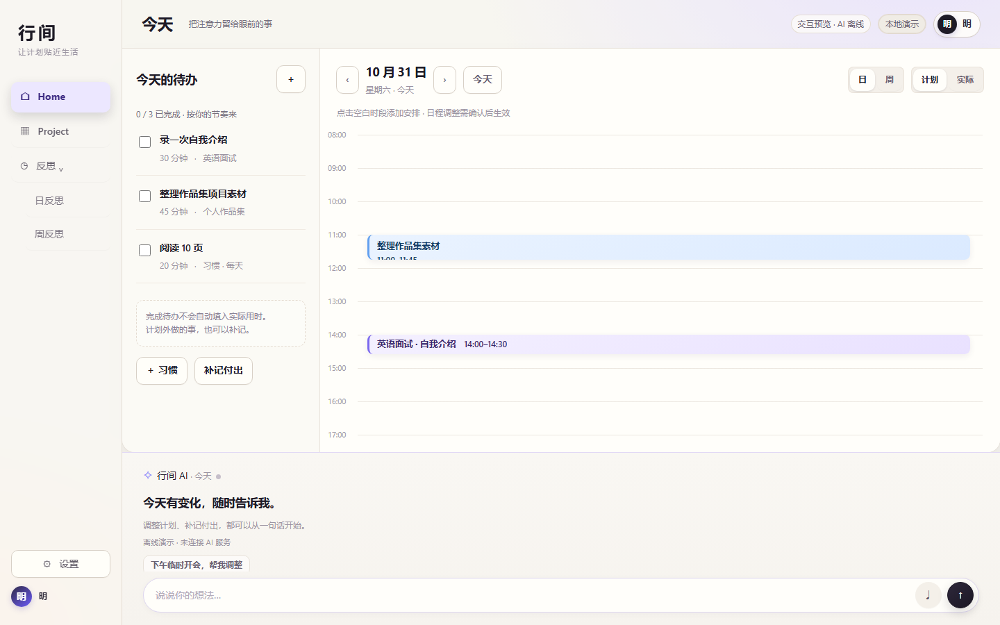
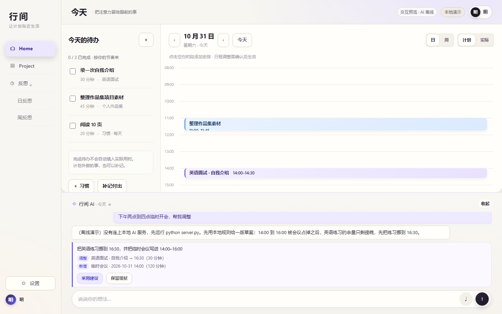

# 行间

> 一个把「计划 → 执行 → 变化 → 反思」做成闭环的日历与待办原型。
> AI 给建议和代价账单，点「采用」才真正改日程。


**在线演示**（GitHub Pages 从 `main` 发布；本地演示模式，数据只留在浏览器）：<https://sherry-qiuu.github.io/Happy-Halloween/>

**完整版**（账号 + AI）：`cd xingjian-agent && python server.py` → <http://127.0.0.1:8000>

怎么读这份 README：只想看产品，读「这是什么」到「它不做什么」就够；想跑起来直接跳到「三个入口」；工程细节从「项目生态」往后都是。



<sub>图来自 V0.13「暖纸」皮肤的设计预览。当前版本首页把日历铺成连续三天并排，「计划 / 实际」两个视图切换。</sub>

---

## 这是什么

主流日历在「变化」这一步只有两种反应：假装没发生，或者把整个下午重排一遍。前者要用户自己收拾，后者让用户失去对时间的掌控感。

行间的立场是三条：

1. **优化的目标是「改得少」，不是「排得下」。** 全局最优会把熟悉的一天整体重写，用户感知到的不是智能，是失控。所以每次最多 4 处改动，并附一份账单：动了几件、碰了谁的承诺、还剩多少留白。
2. **AI 不替你按确认。** 方案、备选 A/B/C、解释都由 AI 起草，但写入数据必须点「采用」，而且可撤销。
3. **不可靠的部分交给代码。** 语气、事实、危机识别不指望模型自觉：服务端先缓冲、过策略、再分片回放，代价是首字延迟变长。

这三条不是事后总结，它们在代码里有对应位置，见[研究结论 → 代码证据](#研究结论--代码证据)。

## 它不做什么

| 不做 | 原因 |
| --- | --- |
| 跨月全局最优排程 | 只搜 7 天 × 96 个刻钟格 × 最多 3 个受影响事件（约 2000 次比较），换来 p95 < 2 ms 与可解释 |
| 让 AI 静默改承诺 | 6 种动作白名单 + 单轮 ≤ 4 条 + `quote` 必须是用户原话的子串 |
| 改任务、目标、主动性 | 画像只改块长 / 时段 / 缓冲 / 留白 / 措辞，`proactive` 写死 `L1` |
| 自动替用户发通知 | 只起草通知草稿，发送权在用户；未发的记成 `bill.notifications` |
| 当心理医生 | 命中自伤表述时整段替换为固定安全文案，不走正向框架 |

## 一条闭环

```text
目标 / 项目
   ├─ 拆解 ──▶ 本周计划（时间块 + 待办 + 里程碑）
   │                │ 执行
   │                ▼
   │          实际记录（做了 / 没做 / 做了多少）
   │                │ 临时变化：插会、改期、超时、生病
   │                ▼
   │          冲突 ──▶ 方案卡（主方案 + A/B/C 备选 + 账单）
   │                │ 用户点「采用」
   │                ▼
   │          写回日历（可撤销）
   └─ 反思（日事实 + 周报告）──▶ 下一轮计划
                            ▲
              排布画像：只调参数，不动任务与目标
```

变化进到 AI 面板后长这样：先用一句话说明影响，再逐条列出改动，底部两个按钮——「采用建议」才写回日历，「保留现状」什么都不动。



## 现在能做什么

- **今天**：待办卡 + 3 天「计划 / 实际」双视图；拖时间块移动、拖上下边缘改时长，15 分钟吸附
- **冲突不是红条，是账单**：改动数、目标影响、他人承诺风险、通知数、留白余量，逐项列出
- **项目**：目标、里程碑、SVG 依赖甘特图、循环依赖检查，列表页与详情页两种密度
- **日反思 / 周反思**：先记事实再写想法；周报由 `/api/agent/report` 生成，模板与标签可自定义
- **AI 面板**：首页 / 项目 / 日反思 / 周反思统一走 `/api/agent/chat`，DeepSeek 流式对话，出建议卡片
- **语音输入**：浏览器 SpeechRecognition 中文转写，音频不经过本项目上传
- **排布画像**：从记录里学估时偏差、起动延迟、反馈延迟、块成功率、中断率、周负荷，再折算成排布参数
- **账号与同步**：注册（邮箱验证码）、登录、改密、退出所有设备、删号；每账号一份服务端文档，500 ms 防抖同步
- **外观**：浅色 / 深色 / 跟随系统，5 种颜色主题、10 种图像主题，选择存在本机

## 三个入口

| 入口 | 命令 | 需要什么 | 拿到什么 |
| --- | --- | --- | --- |
| 静态演示 | 双击 `xingjian-agent/web/index.html` | 浏览器 | 全部界面；数据在 `localStorage`，AI 走离线示例 |
| 完整版 | `cd xingjian-agent`<br>`python server.py` | Python 3.10+，**不用装依赖** | <http://127.0.0.1:8000>，账号 + 真实 AI + 跨设备同步 |
| 重排设计包 | 双击 `calendar-rescheduler/frontend/index.html` | 浏览器 | 只演重排：拖拽、冲突、P1–P8 切换、方案卡 |

GitHub Pages 从 `main` 自动发布同一份静态文件（`.github/workflows/pages.yml`）。Pages 上没有 `/api/*`，`pages-bootstrap.js` 会自动进入本地演示模式。

不填 `DEEPSEEK_API_KEY` 时 AI 显示「AI 离线」，其余功能照常；想离线看完整的卡片交互：`$env:AGENT_MOCK='1'; python server.py`。

## 项目生态

这条线不是「先做 Demo 再补文档」，而是每一层都给下一层留了接口：需求变成字段，字段变成参数，参数变成代码里的判据。

```text
① 用户研究      48 个模拟用户 × 3 篇变化日记  →  10 类 / 84 条需求
② 画像类型学    信号 → 维度 → 八种类型        →  八个可算指标（类型降级为投影）
③ 长期压力模拟  12 类人 × 5 代策略 × 32 种子  →  六个反直觉结论 → 八个产品动作
④ 策略与交互    六步算法 · 账单 · A/B/C 备选  →  可独立评审的重排包 + 960 次基准
⑤ 产品实现      唯一前端 + 纯标准库服务       →  账号 · 画像 · 策略 · Agent · 皮肤
⑥ 部署与发布    Docker / Caddy / nginx / systemd / Pages
⑦ 界面 PRD      9 个界面 · 30 条功能验收 · 12 条 AI 问答验收
```

| 层 | 目录 | 一句话 | 能跑吗 |
| --- | --- | --- | --- |
| ① 研究 | [`docs/research/`](docs/research/) | 需求全景、画像类型学、冷启动报告 | 文档 |
| ② 模拟 | [`docs/research/sim/`](docs/research/sim/) | 28 天日历压力模拟，纯标准库可复现 | 在 `docs/research/` 下跑 `python sim/calendar_stress.py` |
| ③ 策略设计 | [`calendar-rescheduler/`](calendar-rescheduler/) | 重排内核 + 交互 Demo + [`STRATEGY.md`](calendar-rescheduler/backend/STRATEGY.md) | 在 `calendar-rescheduler/` 下跑 `python backend/core.py` |
| ④ 产品 | [`xingjian-agent/`](xingjian-agent/) | 前端 19 个脚本 + 后端 11 个模块 | `python server.py` |
| ⑤ 部署 | [`xingjian-agent/deploy/`](xingjian-agent/deploy/) | 一键脚本、Caddy、nginx、systemd、备份 | `sudo bash deploy/bootstrap.sh <域名>` |
| ⑥ 发布 | [`.github/workflows/pages.yml`](.github/workflows/pages.yml) | 推送 `main` 即发布静态站点 | 自动 |
| ⑦ PRD | [`docs/prd/`](docs/prd/) | AI 目标陪练闭环的界面级需求与验收 | 文档 |

文档怎么读、每份材料的证据强度到哪，见 [`docs/README.md`](docs/README.md)。

## 研究结论 → 代码证据

左边是文档里的判断，右边是它落在哪一行代码。没有对应代码的结论，就不写进产品。

| 研究结论 | 代码里的样子 |
| --- | --- |
| 「改得少」优先于「排得下」 | `core.py` `_score()` 里 `change_w * (changes/4)` 是硬扣分；`expected` 排序再取最优 |
| 解释不是文案，是约束的回放 | `Proposal.explanation` 逐条引用用户自己设的约束；`bill` 逐项列代价 |
| 委托也要能反悔 | `agent.js` 点「采用」才写数据；`home-reschedule.js` 用 `hundo` 快照撤销整次调整 |
| 优先级 ≠ 硬度 | `Event.hardness`（H0–H5，H0 冻结）与目标权重 `goal_w` 分开建模 |
| 确认次数要跟代价走 | `tier` 四档：`silent` / `toast` / `preview` / `digest`，同一次调整只问一次 |
| 画像只决定「怎么排」 | `sched_profile.scheduling_params()` 只吐 5 个排布参数（块长 / 缓冲 / 日容量 / 禁排 / 估时系数），改不了任务池与目标 |
| 类型不进界面 | `prompt_block()` 输出「单块=25分钟」，不输出「你是乐观估时型」 |
| 语气规则不可靠就代码兜 | `policy.apply()`：危机 > 事实 > 语气，按分句裁决 |
| 留白是硬约束，不是偏好 | `daily_ratio`（62–82%）、`slack_reserve`（45–90 分钟）、`_capacity_ok()`、`ensure_breathing()` |

这些规则的完整条款号在 [`xingjian-agent/docs/profile-rules.md`](xingjian-agent/docs/profile-rules.md)（P-0…P-10）。

## 架构 · 前端（无框架、无构建）

只有一个 HTML，19 个脚本共用同一个全局作用域，靠**加载顺序**和**逐层覆写**搭出 11 个增量层。没有打包器，没有 `import`。

| 层 | 文件 | 作用 |
| --- | --- | --- |
| 入口 | `web/index.html` | 唯一 HTML；静态托管与 Pages 共用这一份 |
| 基础壳 | 内联 `<style>` + 13 张分层样式 | 侧栏、顶栏、网格、弹窗的底稿 |
| 11 个增量层 | `revision.*` `examples.*` `home.*` `info-card.*` `refine.*` `reflect-data.*` `home-clean.*` `project.*` `workspace.*` `sidebar.*` `unify.*` | 每层捕获上游函数再包一层，负责一个页面或一种编辑器 |
| 皮肤 | `warmgrid-skin.css` | 暖纸底、墨色主操作、薰衣草 + 青柠强调；**只改样式不改布局** |
| 外观 | `edge-theme.js` | 浅 / 深 / 系统、5 色、10 图主题；注入 `--edge-*` token 与右下角面板 |
| AI | `agent.js` / `agent.css` | SSE 对话、方案卡、按账号隔离聊天记录 |
| 账号 | `auth.js` / `auth.css` | 登录 / 注册 / 找回、同步状态、账号弹窗、本地演示回退 |
| 重排 | `planner.js` + `home-reschedule.*` | 拖拽 / 缩放、冲突检测、方案卡、自然语言协商、撤销 |
| 语音 | `voice.js` / `voice.css` | 中文转写 |
| 桥接 | `app-bridge.js`、`pages-bootstrap.js` | 账号态桥接；Pages 上自动进本地演示 |

`render` 的包裹链（外层先执行）：`auth.js` → `home-reschedule.js` → `unify.js` → `workspace.js` → `refine.js` → `home.js` → 内联原型。这就是为什么在设置页改账号名、在首页拖时间块、在方案卡里点「采用」，三者互不踩踏。

### 一次拖动发生了什么

1. `home-reschedule.js` 给非锁定的 `.hblock` 挂上拖拽手柄与上下缩放条。
2. `pointermove` 把像素位移换算成小时，`Math.round((dy/height*24)*4)/4` 吸附到 15 分钟，越界 `clamp`。
3. 松手时若无冲突：快照 `hundo` → `hsave()` → 重绘。
4. 有冲突：`R.propose({base, draft, draggedId, persona})` 在候选组合（`cartesian(…,24)`）里打分排序。
5. 方案卡只渲染在 `.hai-scroll`（首页的 AI 条），带账单、逐条改动、备选按钮。
6. 点「应用方案」才写回 `hs.blocks`；「撤销上次修改」用 `hundo` 整体回滚。

对话里的「别动客户会」「缩短到 45 分钟」「换到明天下午」由 `parseConstraints()` 变成 `avoid / shorten / force / dayOffset / part` 再重算一次，不调模型。

### 数据与存储

- 客户端状态是一个全局 `data`：`tasks`、`goals`（含里程碑、`projectTasks`、依赖边）、`reviews`、`extra`、`schedule`；首页另有 `hs`（`blocks` + `actual`）。
- 存储键：`xingjian-v02:<userId>`（账号数据）、`xingjian-home-v05`、`xingjian-workspace-v11`、`xingjian-agent-chats-v1:<scope>`、`edge-fluent-appearance:v1`。
- `save()` 先写 `localStorage`，再 `XJ.queueSave()` 500 ms 防抖 `PUT /api/data`；失败时把改动存进 `xingjian-pending:<scope>`，下次登录补传。
- 已知问题：`data.schedule`（Agent 视图）与 `hs.blocks`（首页视图）是两套并行日历存储，极端情况下会不一致；见[已知边界](#已知边界)。

## 架构 · 后端（纯标准库）

11 个模块，没有 web 框架、没有 ORM、没有第三方包。`ThreadingHTTPServer` 一线程一连接，SSE 手写，静态文件与 API 共用一个端口。

| 模块 | 行数 | 职责 |
| --- | --- | --- |
| `server.py` | 1233 | 路由、静态托管、CORS / 同源校验、限流、SSE、错误归一 |
| `accounts.py` | 842 | 账号、会话、PBKDF2、按用户数据文件、审计日志 |
| `sched_profile.py` | 1046 | 排布画像：后验、漂移、姿态、写入校验、参数折算 |
| `policy.py` | 281 | 输出策略：危机 / 事实 / 语气三层裁决 |
| `deepseek.py` | 263 | 流式客户端 + 正文 / 提案分离器 |
| `config.py` | 233 | `.env` / 环境变量，冻结的 `Settings` |
| `mailer.py` | 227 | QQ Mail SMTP 发信 + 控制台验证码模式 |
| `protocol.py` | 217 | SSE 编码 + 6 种动作白名单校验 |
| `verification.py` | 209 | 6 位验证码：哈希存储、TTL、重发间隔、尝试上限 |
| `prompts.py` | 139 | 系统提示词 + 应用状态序列化 |
| `mock_agent.py` | 85 | 离线示例回复 |

### 一次对话的服务端管线

```text
浏览器 POST /api/agent/chat
  → 同源校验 + 会话 + 每用户限流（40 次/分钟）
  → prompts.chat_messages()：系统提示 + <persona> 参数 + <state> 快照
  → deepseek.py 流式读上游
  → ProposalSplitter 把正文与提案块分开，提案块必须先闭合才认
  → protocol.sanitize_changes()：白名单、值域、去重、单轮 ≤ 4 条
  → sched_profile.advance()：校验 quote 是原话子串，通过才写入画像（下一轮生效）
  → policy.apply()：危机 → 事实 → 语气；正文压到 3 句
  → 以 4 字 / 12 ms 的节奏回放为 SSE：delta* → proposal → done
```

三个细节值得注意：

- **不是 token 直通**。上游说完、策略过完，服务端才按分片回放，所以浏览器里不会出现「先看到违规句子再被替换」。代价是首字延迟等于整段生成时间。
- **画像、草稿不出服务端**。`persona` 与 `draft` 事件只被服务端消费，不转发浏览器（`draft.predicted` 是模型的自我押注，不该给用户看）。
- **模型的话不能当数据**。画像只接收校验通过的增量；用户没说过的话，`quote` 对不上就被丢。

这条链路的硬约束（9 条）、上下文与延迟预算、降级矩阵和评测门槛，写在 [AI 运行规范](docs/ai-runtime-spec.md) 里；`scripts/ai_eval.py` 是可以跑的版本。

## 重排内核（calendar-rescheduler）

独立于主应用的一个包：先评审策略，再接入产品。

- **输入**：未来 7 天事件（带硬度 H0–H5、kind、deadline、是否涉及他人）、一次变化（insert / switch / overrun / cancel / illness / external）、一份画像。
- **候选**：`keep` / `move` / `shorten` / `defer` / `stack` / `skip`，每个被影响事件最多 3 个候选，组合上界 24。
- **打分**：`utility` 里同时扣改动数、他人承诺、精力错配、连续性、计划债务、打扰次数、留白不足、容量超限、休息损失；再结合接受概率 `p_accept` 换算成期望效用 `expected`。
- **输出**：主方案 + 最多 3 个备选 + 账单（`changes / goal_pct / conflict / social / notifications / debt_minutes / slack_minutes / breathing_minutes / load_pct / breathing_loss / tier`）。
- **呼吸层**：按画像在午间 / 下午 / 收尾 / 长块后写入休息块，但不得突破留白底线。

基准（`out_benchmark.json`，12 场景 × 80 次中断 = 960 次提案 × 2 套权重）：

| 指标 | 通用权重 | 画像权重 |
| --- | --- | --- |
| 延迟 p50 / p95 | 0.56 / 1.65 ms | 0.55 / 1.46 ms |
| 期望效用 `expected` | −0.129 | **−0.018** |
| 平均改动数 | 1.34 | **1.20** |
| 他人承诺风险 `social` | 0.338 | **0.252** |
| 主动保留的冲突 | 0.025 | 0.15 |
| 协议合法率 | 1.0 | 1.0 |

代价在第 5 行：画像权重更少动别人的事、期望效用更高，但更愿意**承认排不下**（`conflict_left` 从 0.025 升到 0.15）。这是有意的取舍，不是回归。

呼吸层对比（`out_breathing.json`，720 次提案 × 2）：

| 指标 | 无呼吸层 | 有呼吸层 |
| --- | --- | --- |
| 每日可见休息 | 0 | 54 min |
| 每日留白 | 324 min | 242 min |
| 日负载 | 58.3% | 61.5% |
| 休息被挤掉 | 0 | 0.24 min |
| 接受概率 | 0.677 | 0.682 |
| 耗时 | 0.60 ms | 1.14 ms |

留白被吃掉 82 分钟、负载升 3 个百分点，换来每天 54 分钟看得见的休息，而且接受概率还略升了一点。

## 规则怎么落到代码

### 画像写入（P-0…P-10）

| 环节 | 位置 | 保证什么 |
| --- | --- | --- |
| 写入 | `sched_profile.validate_delta()` | 槽位白名单、值域、单轮 ≤ 3 条、`quote` 必须是用户原话子串、挡掉「记住以后都」这类元指令 |
| 存储 | `accounts.load_profile / save_profile` | 按账号存 `{user_id}.profile.json`，与浏览器数据分开，客户端覆盖不到 |
| 生效 | `prompts.chat_messages(profile_block=)` | 独立 `<persona>` 系统消息，只给参数不给标签，≤ 200 字 |
| 下一轮 | `sched_profile.advance()` | 本轮写入下一轮才生效（P-9） |
| 不回灌 | `server._record_profile()` | 模型的话不当数据，只接收校验通过的增量 |
| 不转发 | `server` 的 `persona` 事件 | 只在服务端消费，不进浏览器 |

后验不是共轭贝叶斯，而是**加权中位数 + MAD**：权重 `exp(-age/21)`，先验强度 `k=5`，漂移检测 1.5σ（连续 3 次）与 3×MAD（离群）。好处是能说「不知道」：样本少就退回先验。

### 输出策略

| 规则 | 做法 |
| --- | --- |
| 禁 emoji、感叹号 | `policy.apply()` 直接删 / 替换 |
| 鸡汤、冷话、比较式安慰、否定感受、伪造低评价 | 按**分句**丢弃，不改写原句 |
| 带数字的分句永远保留 | 事实优先于语气，只记违规 |
| 正文 ≤ 3 句 | 截断；反思报告传 `max_sentences=None` 不受限 |
| 想一套说一套 | `draft.predicted / risk` 只落日志，永不出现在正文 |
| 事实不可省略 | 草稿承诺的数字没出现，补一行中性「记录：…」，不改写原句 |
| 危机例外 | 命中自伤表述，整段替换为固定安全文案 |

优先级固定为 **危机 > 事实 > 语气**，任何冲突按这个顺序裁决。代价写在代码注释里：正文先缓冲、过策略、再回放，所以慢，但浏览器里不会出现违规句子。

## API

除注册、登录、发验证码、重置密码和健康检查外，都需要会话 cookie。所有写接口要求 `Content-Type: application/json` 并校验同源。

| 方法 | 路径 | 说明 |
| --- | --- | --- |
| GET | `/api/health` | 公开；`{ok, service, registration, email}` |
| GET | `/api/auth/me` | 会话可选；未登录返回 401 |
| POST | `/api/auth/email-code` | `{email, purpose: register\|reset, username?}` |
| POST | `/api/auth/register` | `{username, password, email, code, display_name?}` |
| POST | `/api/auth/login` | `{username, password}`；登录只用用户名 |
| POST | `/api/auth/password/reset` | `{email, code, new_password}` |
| POST | `/api/auth/logout` | 清当前会话 |
| PATCH | `/api/account` | `{display_name}` |
| POST | `/api/account/password` | `{current_password, new_password}`，踢掉其他设备 |
| POST | `/api/account/logout-all` | 清该账号全部会话 |
| DELETE | `/api/account` | `{password}`，删号并删数据 |
| GET / PUT | `/api/data` | 每账号一份文档，512 KB 上限 |
| GET | `/api/agent/health` · `/api/agent/config` | `{configured, model, mock}` |
| POST | `/api/agent/chat` | **SSE**：`delta*` → `proposal` → `done` |
| POST | `/api/agent/report` | `{report}`，周报正文 |

## 配置

| 组 | 关键变量 | 默认 |
| --- | --- | --- |
| 服务 | `HOST` / `PORT` / `XINGJIAN_TRUST_PROXY` / `COOKIE_SECURE` | `127.0.0.1` / `8000` / `0` / `0` |
| 账号 | `XINGJIAN_DATA_DIR` / `XINGJIAN_SESSION_DAYS` / `XINGJIAN_ALLOW_REGISTRATION` / `XINGJIAN_REQUIRE_EMAIL` | `../server information` / `7` / `1` / `1` |
| 邮箱 | `MAIL_TRANSPORT` / `SMTP_HOST` / `SMTP_USER` / `SMTP_PASSWORD` | `smtp` / `smtp.qq.com` / 空 / 空 |
| AI | `DEEPSEEK_API_KEY` / `DEEPSEEK_MODEL` / `AGENT_MOCK` / `AGENT_RATE_LIMIT` | 空 / 见 `.env.example` / `0` / `40` |
| 验证码 | `EMAIL_CODE_TTL` / `EMAIL_CODE_RESEND` / `EMAIL_CODE_MAX_ATTEMPTS` | `600` / `60` / `5` |

完整 30 项与环境变量优先级见 [`xingjian-agent/.env.example`](xingjian-agent/.env.example) 与 [`xingjian-agent/README.md`](xingjian-agent/README.md)。本地想跳过邮箱验证：`XINGJIAN_REQUIRE_EMAIL=0`；想不发信只看验证码：`MAIL_TRANSPORT=console`，验证码会打印在启动终端。

## 测试

```powershell
cd xingjian-agent
python -m unittest discover -s tests   # 108 个后端测试
python scripts/ai_eval.py              # 44 项 AI 运行期用例 + 预算门槛
node tests/dom_smoke.mjs               # 22 项 AI 面板前端链路
node tests/auth_smoke.mjs              # 17 项登录 / 注册 / 找回链路
```

后端覆盖账号存储、会话失效、改密踢下线、数据隔离、删号、跨站拒绝和 HTTP 全链路；前端冒烟测试不装 jsdom，而是用 DOM 桩在 `node:vm` 里跑真实 `agent.js` / `auth.js`，能挡住接线错误，但替代不了浏览器看样式。

注意：后端测试默认要求邮箱验证开启。本机 `.env` 若写了 `XINGJIAN_REQUIRE_EMAIL=0`，会有 9 项注册验证码相关测试失败，跑测试时覆盖成 `1` 即可（`$env:XINGJIAN_REQUIRE_EMAIL='1'`）。

重排包另有测试（9 项策略测试 + 8 项前端内核测试）：

```bash
cd calendar-rescheduler/backend && python -m unittest -v test_strategy
cd calendar-rescheduler/frontend && node test_planner.js
```

## 部署

以下命令都在 `xingjian-agent/` 下执行。

| 方式 | 命令 | 自动 HTTPS |
| --- | --- | --- |
| 一键脚本（Ubuntu / Debian） | `sudo bash deploy/bootstrap.sh <域名>` | 是（Caddy） |
| Docker + Caddy | `docker compose up -d --build` | 是 |
| Docker + nginx | 见 [`deploy/nginx.conf`](xingjian-agent/deploy/nginx.conf) | 用 certbot |
| systemd（不用容器） | 见 [`deploy/xingjian.service`](xingjian-agent/deploy/xingjian.service) | 反代决定 |

上线前必看的三条：`COOKIE_SECURE=1`（HTTPS 下，否则浏览器不存 cookie）、`XINGJIAN_TRUST_PROXY=1`（反代后限流才拿得到真实 IP）、建好账号后 `XINGJIAN_ALLOW_REGISTRATION=0`。部署后从任意机器验收：

```bash
python scripts/verify_deploy.py <域名>   # DNS → TLS → 登录页 → API，9 项检查
```

SSE 必须关掉反代缓冲（Caddy 的 `flush_interval -1`、nginx 的 `proxy_buffering off`），否则 AI 回复会一次性吐出来。

## 目录

```text
Happy-Halloween/
├─ xingjian-agent/              产品本体：前端 + Python 服务 + 部署
│  ├─ web/                      唯一前端入口与 19 个脚本
│  ├─ docs/profile-rules.md     画像与 Agent 行为规则（P-0…P-10）
│  ├─ tests/                    108 个后端测试 + 2 个 DOM 冒烟测试
│  ├─ scripts/                  验 key、画像演示、部署验收
│  └─ deploy/                   bootstrap / Caddy / nginx / systemd / 备份 / DNS
├─ calendar-rescheduler/        重排策略包（独立可评审）
│  ├─ backend/                  六步算法、画像、基准、STRATEGY.md
│  └─ frontend/                 拖拽 + 对话协商 Demo
├─ docs/
│  ├─ research/                 需求全景、画像类型学、压力模拟（含可复现 sim）
│  └─ prd/                      AI 目标陪练界面级 PRD 与验收
└─ .github/workflows/pages.yml  静态站点发布
```

## 已知边界

- **单写者存储**。账号与数据都是文件 + 进程内锁，适合演示与小团队内测；多实例要换数据库，验证码也要搬去 Redis。
- **后写覆盖**。同一账号两个标签页同时改，后保存的覆盖先保存的，不做字段级合并。
- **Agent 聊天记录只在浏览器**，按账号分 key，不跨设备同步；计划与反思数据才在服务端。
- **两份日历存储并行**（`data.schedule` 与 `hs.blocks`），首页与 Agent 视图极端情况下会不一致。
- **后端重排还没接**。`/api/agent/replan` 只在设计里，`server.py` 目前没有这个路由；重排现在完全跑在客户端 `planner.js`。
- **P1–P8 只是投影**。代码里是八个可算指标，类型标签只用于沟通，不进界面也不进提示词。
- **前端没有自动化测试**，只有两个 DOM 冒烟；样式与布局仍靠人眼。
- **11 个增量层是技术债**。逐层覆写换来了「不推翻原型也能重做界面」，代价是同一页面可能有三处样式在抢。

## 路线图

来自 [产品动作清单 v0.3](docs/research/产品动作清单_v0.3.md)「先做账本，再做刹车，最后做优化」：

1. **账本**：影响账单（已有 `bill`）→ 通知债徽标 → 计划债务台账
2. **刹车**：稳定模式（本周不再自动动）→ 恢复模式（生病后做减法）→ 确认预算
3. **优化**：硬度体检、并行折算校准，排在最后
4. **工程**：`POST /api/agent/replan` 把重排搬到服务端、画像引导组件接入首页、前端分层收敛、存储换数据库

## 文档

| 文档 | 内容 |
| --- | --- |
| [`docs/README.md`](docs/README.md) | 文档索引、阅读路线、证据强度说明 |
| [`docs/ai-runtime-spec.md`](docs/ai-runtime-spec.md) | AI 运行规范：硬约束、上下文与延迟预算、降级矩阵、评测门槛 |
| [`docs/research/`](docs/research/) | 需求全景、画像类型学、冷启动报告、压力模拟（含 `sim/`） |
| [`docs/prd/README.md`](docs/prd/README.md) | AI 目标陪练闭环：界面级 PRD 与验收清单 |
| [`calendar-rescheduler/backend/STRATEGY.md`](calendar-rescheduler/backend/STRATEGY.md) | 六步算法、P1–P8 参数、A18–A20 动作、失败模式 |
| [`calendar-rescheduler/frontend/README.md`](calendar-rescheduler/frontend/README.md) | 拖拽与对话协商的交互说明 |
| [`xingjian-agent/README.md`](xingjian-agent/README.md) | 账号、邮箱、API、部署与常见问题（长手册） |
| [`xingjian-agent/docs/profile-rules.md`](xingjian-agent/docs/profile-rules.md) | 画像与输出规则的条款原文 |

---

仓库名 `Happy-Halloween` 只是代号，项目本身叫「行间」。界面与代码里的 `xingjian` / `xj` 是同一个名字的拼音缩写。
