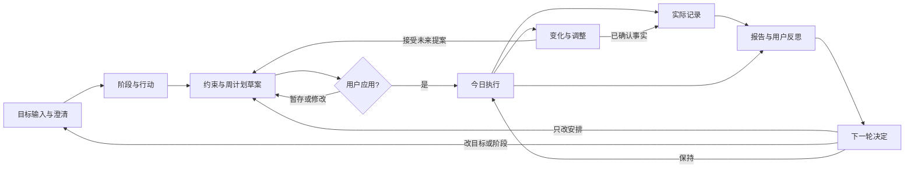
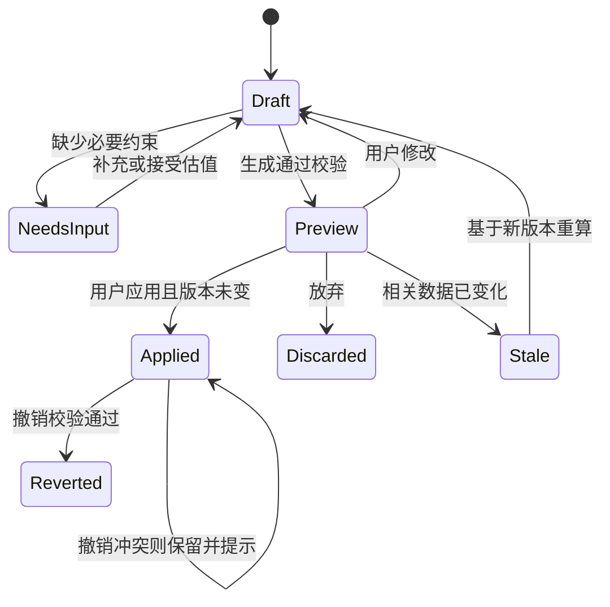

# AI 目标陪练｜界面级产品需求文档

版本：V0.1；日期：2026-10-31；修订人：Codex；状态：可进入原型讨论的建议稿，非开发排期承诺。

| 版本 | 时间 | 变更 |
|---|---|---|
| V0.1 | 2026-10-31 | 基于四张既有闭环图，将 12 个环节落实为 7 个主页面与 2 个抽屉；补齐问答、状态、字段、异常与验收 |

配套阅读：[AI 问答方案比较](01_AI角色与问答方案比较.md)、[验收与评审记录](03_验收清单与评审记录.md)。本文件采用上一份的推荐方案；所有新增默认规则均是设计建议，不是用户已经确认的需求。

## 一、概述：为什么做

### 1.1 背景、目标与假设

已有个人经历证据：临时变化后需重新思考和手动改计划；计划外工作未被认可；晚间反思要重复查日历，长期记录无法有效衔接。现有流程已确定方向：输入目标 → 拆解阶段与行动 → 近期排程 → 执行与实际记录 → 事实报告 → 用户反思 → 调整目标或未来计划。

产品概述：帮助有个人目标和规划需求的用户，把目标转为可执行行动；变化发生后处理受影响安排，保留计划内外的真实付出，并让反思成为下一轮决策依据。

**用户假设**：已有计划习惯、日程有一定自主权的个人；先覆盖学习或个人项目，不假定只服务学生。旧方案为日历＋任务/积分工具＋独立反思平台的组合；跨用户普遍性未验证。

| 目标 | 指标口径 | 首轮判断方式 |
|---|---|---|
| 减少变化后的重新规划负担 | 用户表达变化至接受调整的主动操作时间、手动取舍次数、主观费力程度 | 与同一人的现有做法对照；先采基线，不编目标提升比例 |
| 计划外付出能进入回顾 | 已保存计划外记录在报告中的可见性 | 测试样本中的已保存记录全部可查，不能遗漏 |
| 反思能影响下一轮 | 调整决定关联至已应用计划的比例与可追溯性 | 首版至少跑通一个“原因→决定→草案→应用”的案例；保持不变也算有效决定 |
| 控制记录负担与可信度 | 保存记录的操作时间、未知是否如实呈现、越权写入次数 | 未知不填成 0；未授权写入为 0；不以打卡或聊天次数代替价值 |

商业化、长期留存和支付意愿本版不作已验证承诺。目标值与用户范围是待确认 C01；不会因缺少增长数据而阻止制作原型。

### 1.2 名词

| 名词 | 定义与边界 |
|---|---|
| 目标 Goal | 期望成果与意义；有标题即可草稿，进入成果追踪需成功标准 |
| 阶段 Milestone | 目标的一段可观察成果，不等同于某天的日历块 |
| 行动 Action | 一次任务或周期练习；行动计划时间不等于实际成果 |
| 工作时段 Session | 某行动在日历上的准备执行时间，可多段关联同一行动 |
| 原计划 | 所选日期开始前最后一个已生效版本；当日首次创建则用当日首个生效版本，注明“日中首次规划” |
| 最新计划 | 当前最后一个已应用版本；历史草案不计入 |
| 实际记录 Actual | 用户确认的实际活动，允许时长/时刻未知，独立于日历计划 |
| 调整提案 Proposal | 对未来日历或目标的候选变更，未接受前不生效 |
| 反思 Reflection | 用户对经历的解释与感受，AI 不能冒充用户填写 |
| 记忆 Preference | 用户明确接受、可查改删的跨轮偏好；模型猜测不算已确认记忆 |

### 1.3 角色与权限

| 角色 | 可以做 | 不可以做 |
|---|---|---|
| 用户 | 创建目标、推进阶段、确认事实、选取舍、应用或放弃变更、维护偏好 | 不可访问他人数据 |
| AI | 提取信息、问必要问题、提出拆解/排程/摘要/策略候选 | 不能确认事实、静默改期限、自动把计划填成实际、推断未回复即同意 |
| 系统规则 | 校验、统计、版本控制、在授权后提交、提示冲突 | 不靠模型文本判定成功，不绕过用户决定 |

阅读对象：产品、交互设计、研发和测试；无技术栈或模型厂商绑定。

### 1.4 范围与待确认项

| ID | 级别 | 建议默认值 | 影响 |
|---|---|---|---|
| C01 | 必须确认：开发范围 | 桌面 Web、个人使用、已有规划习惯；学习/个人项目为首测场景 | 导航、布局、验证对象 |
| C02 | 必须确认：首版集成 | R0 用产品内日历和手动固定事件；R1 才对接一个外部日历，绝不假装已同步 | 日历接入、任务拆分、交付量 |
| C03 | 必须确认：自动化与数据 | R0 所有未来变更先预览确认；实际仅用户确认；无设备行为监控 | 核心信任与事实来源 |
| C04 | 必须确认：激励范围 | R0 做具体成果与付出反馈，不做积分兑换、养成或社交 | 视觉、反馈模块 |
| C05 | 必须确认：记忆与留存 | 事实默认留至用户删除；AI 未确认候选 30 天清理；确认偏好默认 90 天后复核；反思不自动成为长期偏好 | 存储、删除、个性化；真实上线前需确定数据处理方案 |

其他建议默认值统一见各节：提问阈值、容量缓冲、提醒、字段与超时。它们可在原型阶段采用，团队可集中修改。真实公共上线另需身份隔离与数据处理验收，本文件的完成不等于上线批准。

## 二、产品描述：做什么

### 2.1 故事地图与版本切片

| 发布切片 | 定目标 | 拆行动 | 排时间 | 应对变化 | 留实际 | 回顾 | 改下一轮 |
|---|---|---|---|---|---|---|---|
| R0 最薄闭环 | 文字目标卡、必要澄清 | 用户接受阶段与一个行动 | 内部周日历、三种范围、草案确认 | 新事件/部分完成/状态变化，局部提案 | 手动或计时草稿确认、计划外记录 | 对照报告、一句话反思 | 用户接受一个策略并生成、应用新草案 |
| R1 扩展 | 语音、图片、链接资料解析 | 周期行动模板与复杂依赖 | 一个外部日历接入、多目标体验深化 | 授权边界、外部事件冲突与同步 | 来源更多、批量快捷记录 | 周复盘、导出 | 跨周期试验对比与模式候选 |
| Later | 更多输入与跨应用 | 专项领域模板 | 多日历/团队共享 | 限界自动执行 | 设备级来源需另行授权 | 可选养成反馈 | 高级自适应策略 |

R0 贯穿整条旅程，不是先做完整 AI 聊天模块、最后才接执行与反思。多个目标共享容量；R0 可以创建多个，但每次选择少量行动排程，不承诺多项目全局最优。

### 2.2 信息架构与页面清单

全局导航：今日 / 目标 / 计划 / 回顾；右上角“记忆与设置”。AI 为当前页面侧栏或内嵌区域，不另建必须经过的聊天首页。

| ID | 名称及形态 | 核心问题 | 覆盖环节 | 主出口 |
|---|---|---|---|---|
| P01 | 今日工作台，主页面 | 当下做什么、发生变化如何快速处理？ | S06 | 开始行动、P05、P06、P07 |
| P02 | 目标输入与澄清，主页面 | 想做什么、怎样算进展？ | S01–S02 | 暂存、P03、直接带行动去 P04 |
| P03 | 目标路径与行动，主页面 | 大目标如何变成阶段和下一步？ | S03 | P04、修改目标 |
| P04 | 周计划工作区，主页面，包含约束/草案/生效三态 | 时间容量与行动如何匹配？ | S04–S05 | 应用后 P01、暂存、继续编辑 |
| P05 | 变化与调整，复用抽屉 | 变化影响什么、未来怎样改？ | S07 | 仅存事实、预览应用、保持 |
| P06 | 实际记录，复用抽屉 | 真正发生什么、付出如何被看见？ | S08 | 保存回原页、可选 P05 |
| P07 | 日终报告与自我反思，主页面，分区而非强制向导 | 今天发生什么、用户怎样理解？ | S09–S10 | 保存、纠错、P08 |
| P08 | 下一轮调整，主页面 | 反思怎样变成可选择的下一步？ | S11 | P04 或 P02/P03、保持 |
| P09 | 记忆与偏好设置，主页面 | 系统记住什么、我如何控制？ | S12 | 保存并回来源 |

抽屉只负责短任务；存在较多受影响时段时 P05 内可“展开查看 P04”，保留提案，不重开另一段聊天。手机适配为整屏抽屉，R0 不承诺移动端复杂拖拽。

### 2.3 主流程与反馈路径



图中连线表示可达关系，不意味着用户必须按顺序经过所有页面。P05 的事实在同一抽屉嵌入 P06 组件确认，无需强制离开抽屉；后续拒绝调整不删除已保存事实。

数据流：用户表达 → AI 提取候选 → 用户/规则确认 → 目标或实际记录；已接受行动＋约束＋占用 → 候选时段 → 规则检查 → 用户应用 → 计划版本；计划版本＋实际＋成果证据 → 报告 → 用户反思 → 策略提案 → 新草案。

### 2.4 状态模型



目标另有 draft / active / paused / achieved / archived；只有用户确认成果后 achieved。行动为 todo / in_progress / done / paused / cancelled；不依据计时自动 done。实际记录为 draft / confirmed / corrected / deleted，纠正保留来源但删除必须对正常查询不可见。反思可以未开始、草稿、已保存、已跳过；未知不是失败状态。

### 2.5 全局交互与错误处理

| 场景 | 统一处理 |
|---|---|
| 自动保存 | 输入停止 1 秒保存草稿，显示保存中/已保存/未保存；离开前有未保存内容则提示继续保存、放弃或留在页面 |
| 加载/AI 生成 | 保持现有卡片可读；相关应用按钮禁用，允许停止。仅最新 generation_id 的返回可替换对应候选 |
| AI 超时或失败 | 建议 30 秒转为可重试错误；保留输入和草稿，允许手动编辑。模型失败不能阻止查看已保存日历与事实报告 |
| 网络中断 | 显示未保存状态，禁止把本地草稿称为已生效；恢复后显式重试同一请求标识 |
| 权限/会话失效 | 保留当前浏览器内存草稿，提示重新登录；禁止向未识别用户返回他人记录，不将敏感草稿写入公开缓存 |
| 重复应用 | 同一 request_id 只提交一次；重复点击返回同一结果 |
| 多页并发 | 每次提案包含输入版本；相关版本改变则 stale，展示差异并重算，不用最后写入覆盖用户编辑 |
| 列表排序 | 今日按当前时段/未排程行动；目标按活跃、暂停、归档分组，组内最近修改优先；实际按发生时间，未知时刻单列 |
| 无障碍 | 状态有文字不只颜色；键盘可编辑与确认；拖拽有“改时间”表单等价入口 |
| 跨天/时区 | 用户设置时区决定“今天”和周范围；保存带时区的时间点。跨午夜活动分日展示，同一记录关联；切时区后所有未应用草案重新检查 |
| 删除 | 有实际/反思的目标默认归档。真正删除显示关联范围；不因删除目标而偷偷删除事实，可选解除关联。误删短期撤销窗口为建议，不能代替永久删除流程 |

R0 默认 Asia/Shanghai，可在 P09 修改；所有时间展示明确本地时区。服务端若采用 UTC 是实现选择，但必须保存用户时区语义。夏令时重复或不存在的时间要显式让用户选合法时间。

## 三、功能需求：逐界面实现

### 3.1 P01 今日工作台

**用户故事**：作为已有计划的个人，我希望看到当前最可执行的行动，并快速报告变化，以便少花时间重新找安排。

前置：有会话；允许无目标、无计划进入。后置：行动或实际更新后各视图一致，所有变更有明确反馈。

界面结构：顶部日期与时区；左侧今日时间线；中部“下一步”与未排程行动；右侧 AI 按需入口；底部当天记录摘要。首屏优先行动，不放多层成长图表。

| 控件 | 默认与校验 | 操作反馈及去向 |
|---|---|---|
| 当前行动卡 | 显示目标、行动、预定时长，未排程单列；无候选显示“先选一个行动” | 点击打开行动详情，不自动开始计时 |
| 开始/暂停 | 同一时刻仅一个本地计时器运行；切任务需暂停或明确转移 | 开始进入 in_progress；暂停进入待校对实际草稿，不能直接记完成 |
| 完成 | 可对未计时行动使用 | 弹 P06 成果确认；未填实际时长也能保存，记为未知 |
| 记录变化 | 始终可见 | 打开 P05，预填当前行动与日期 |
| 补记付出 | 始终可见 | 打开 P06，默认计划外、不关联目标 |
| 暂不做 | 不等于取消目标 | 选仅移出今天 / 请求重排 / 暂停行动，再确认影响 |
| 回顾今天 | 不要求全部任务完成 | P07；对还未结束的时间范围标记“截至当前” |

交互顺序：进入读取最新计划 → 确定当前候选（进行中优先；其次当前时段；再由用户选择未排程）→ 用户开始或换一个 → 完成时校对事实 → 提供具体成果反馈。AI 只有点击“帮我开始/换个做法”后提问，遵循 S06。

异常：空状态给“新建目标/直接记一件事”；没有今日计划但有目标可去 P03；计时器跨午夜提示拆日；关闭浏览器后不推断持续专注，恢复时请校对起止和中断。计时运行事实不能作为后台监测行为的依据。

验收 AC-P01：没有今日计划仍可补记；点击开始后没有实际确认，不出现在“已确认付出”统计；完成未知时长任务后其成果可见、用时不显示为 0。

### 3.2 P02 目标输入与澄清

**问题**：从模糊表达走到可编辑目标，避免表单门槛和无限追问。对应 S01/S02。

前置：无；后置：目标草稿保存，用户选定下一步，未确认的拆解不变成行动承诺。

| 区域/控件 | 默认、字段与校验 | 行为 |
|---|---|---|
| 自由输入框 | 1–4000 字；示例非预填内容 | “整理成目标”提取候选；空白禁用 |
| 语音/图片/链接入口 | R0 隐藏上传和录音，只支持粘贴文字；粘贴 URL 可保存为资料链接 | 提示“当前不读取链接内容”，不能宣称已理解附件；R1 解析后仍需确认 |
| 目标卡 | 标题 1–100 字；成功标准至多 500 字；动机可空 | 对话候选与人工编辑同源，人工修正优先 |
| 时间边界 | 硬截止 / 期望日期 / 无截止，未选为待确认，不默认硬截止 | 前两项选日期，硬截止需明确当地截止时间，只有日期则询问而非直接填 23:59 |
| 当前起点 | 可选 500 字 | 影响拆解时才问 |
| 对话区 | 单个必要问题＋可选答案＋自填＋暂不回答 | 已答字段不再问；显示问题理由 |
| 暂存目标 | 只有标题即可保存 | 回 P03 的草稿态或目标列表 |
| 生成路径草案 | 标题必需，其他缺项可生成带假设的阶段草案 | P03，不自动排时间 |
| 开始规划 | 始终显示 | 有选定行动则 P04；无则 P03 并聚焦“先选一个行动”，解释原因 |

流程：输入 → AI 结构化卡片 → 用户确认/修改关键含义 → 必要澄清 → 用户自主选择出口。编辑已有 active 目标时进入目标变更草稿；修改截止或成功标准要显示差异和受影响行动，确认后才提交，旧计划随后标需重评，不自动重写。

异常分支：多目标表达先选一个，其他草稿保留；标题无法识别给手填入口；“一个月左右”保留为候选，需确认具体期望日期或无截止；硬截止在过去可存目标草稿，但不可生成未来可行承诺。AI 错误不丢原文。

验收 AC-P02：用户可不回答动机而进入拆解；日期模糊不会写硬截止；连续拒答后 AI 收尾，不继续逼问；修订目标未确认时原目标与日历不变。

### 3.3 P03 目标路径与行动

**问题**：把目标转为阶段成果与可执行下一步，不把长程目标一次排到分钟。对应 S03。

用户故事：作为尚不知如何开始的人，我希望看到可删改的路径并只选近期行动，以便今天就能开始。

前置：目标至少是草稿；后置：被用户接受的阶段/行动有稳定 ID，可用于排程；AI 未接受候选独立保留。

| 控件 | 默认与校验 | 行为 |
|---|---|---|
| 目标摘要 | 显示成功标准与期限性质 | 回 P02 编辑，保留来源 |
| 阶段卡 | 标题 1–100 字，成果至多 500 字；AI 卡显示待接受 | 接受、编辑、合并、删除；允许单阶段 |
| 行动卡 | 标题 1–100 字；一次任务/周期练习；估时可空 | 接受后进入行动库；没有估时仍可接受但暂不排 |
| 可拆分 | 默认否，用户可改；允许时最短块 5–480 分钟 | 调度不得违反用户选择 |
| 周期练习 | R0 支持选星期几和每次时长，不支持复杂月历规则 | 每次 occurrence 独立记实际，不把连续打卡当目标成果 |
| 依赖 | 可选，不能自依赖或循环 | 有阻塞的后继不能排在前置已知完成前；前置未安排则后继保持未排程 |
| 只安排下一步 | 选中至少一个已接受行动 | P04，只带选中的行动 |

流程：浏览 AI 阶段草案 → 修改或接受阶段 → 选当前阶段 → 生成 1–3 个近期行动作为起点 → 接受至少一个 → 排程。1–3 是生成建议量，不是条数限制。用户可全程手动建行动，跳过 AI。

AI 示例：“先录一段两分钟自我介绍，还是先写提纲？”用户选择后只更新这一行动；不因改一张卡重新生成整条路径。

异常：用户拒绝拆解时转“只写下一步”；循环依赖阻止保存关联并指出关系；删除已有记录的行动转 cancelled/archived，实际记录保留；阶段成果变更不自动标 done。暂停目标时取消其未来时段需预览确认，不抹历史。

验收 AC-P03：未接受行动不会出现在排程；远期阶段没有硬填每日时间；删除或暂停不丢实际付出；用户能只安排一个行动。

### 3.4 P04 周计划工作区

**问题**：将真实容量、必要约束与行动匹配，并让用户看清排入与未排入。覆盖 S04/S05，也是 P05/P08 共用的变更预览页。

前置：选中行动或有效提案；后置：应用才产生新计划版本；暂存、拒绝和生成失败均不改变生效日历。

布局：左侧行动池/未排入；中央日历；右侧约束与 AI 解释；底部固定“暂存 / 重新生成 / 应用”操作条。约束与草案在同页切换，不拆成三次导航。

| 控件 | 默认与校验 | 反馈 |
|---|---|---|
| 规划范围 | 当前自然周（周一至周日）/未来 7 天/自定义 | 自定义 1–28 个自然日为首版建议上限；选择后显示起止日期与时区 |
| 未来可用时段 | 默认空，需要用户选择或使用已确认偏好；R0手动固定事件也作为占用 | 只对现在之后的区间生成计划；不可排到过去 |
| 投入预算 | 本次范围的投入分钟数，不能把全周承诺自动当剩余预算 | 与实际未来可用容量对照显示；可少于容量 |
| 估时卡 | 行动需有已确认的 5–480 分钟估时或本次工作量；大于上限先拆阶段/工作段 | 缺项给接受估值/自己填/暂不安排；未接受估值不入日历 |
| 缓冲 | 建议保留当前自由容量的 20%，按 5 分钟取整；用户可改 0–50% | 以不安排的空余容量体现，展示具体分钟，不能重复算成休息事件 |
| 重要程度 | 高/中/低，默认中并可改；不等同于硬截止 | 同级优先已存在安排，减少扰动；明确依赖优先于分值 |
| 时间块 | 点击改时间或拖拽；5 分钟步长 | 改动只生成本地候选并校验，不静默应用 |
| 未排入区 | 显示原因：缺信息/容量不足/依赖未满足/截止风险 | 用户可减范围、换日期、保留未排程，不作为系统失败隐藏 |
| 变更差异 | 首次计划展示新增；修订展示新增/移动/取消及原因 | 可逐项排除，但排除后必须重新整体校验 |
| 应用 | 无非法冲突且有有效变更时可点 | 展示变更摘要后提交；成功显示版本和“去今日” |

默认日期示例：2026-10-31 创建当前自然周计划，范围是 10-26 至 11-01，但只安排当前时间后的时段；未来七天是 10-31 至 11-06。若当前周不够，只展示未排入或主动换范围，绝不把七天量塞到周末。

生成顺序：读取目标、已接受行动、所有目标共享的占用、约束与版本 → 计算可用容量 → 检查依赖和截止 → 优先保留合法既有时段 → 将剩余行动安排到合法时段 → 输出草案/未排入/风险 → 用户编辑 → 应用前重新读取相关版本 → 事务提交。

工作量守恒：一次性行动区分原估时与用户确认的剩余估时，发生部分完成后不从原估时机械减去实际分钟。新草案内保留时段与新增时段之和不得重复安排同一份剩余工作；既有未来时段已经覆盖的部分不能再排一次。只选“本次练习30分钟”是明确的工作段承诺，不宣称整个目标或行动因此做完。依赖必须明确到已确认完成或本草案中前置工作完成后；没有可靠完成预期的后继保留未排程。

业务边界：固定会议不可被 AI 移动；休息、锁定时段不当作可挤占空位；硬截止前必须容纳完整剩余行动才可声称可完成。估时不保证成果，界面表述为“按当前估时可排入”，不保证一定达标。

无解与部分应用：若部分行动可排，用户可以应用合法部分，但明确未排入项和目标风险；硬截止被违反的时段不能作为有效任务安排写入。缩短时段若意味缩小任务范围，必须另行接受新的最小行动，不能偷改原任务工作量。

撤销：仅撤销该版本改变的未来安排；若存在之后的新变更则生成反向草案，用户重新确认。记录事实和已发生工作不随撤销改变。

AI 问答遵循 S04/S05；确认采用按钮加差异卡，不依赖识别一句模糊“好”作为写入授权。模型不可用时用户仍能手动安排符合约束的时段。

验收 AC-P04：三种范围可切换；只排未来；未知估时不被偷偷补齐；两个目标不重复占用同一空闲；版本改变导致旧草案不可直接应用；未排入可见；关闭预览不改日历。

### 3.5 P05 变化与调整抽屉

**问题**：把一段变化描述转为可靠事实/约束，再低成本决定是否改未来。对应 S07。

前置：P01/P04/P07 任意入口；后置：已保存事实、新约束、候选安排分别有状态与去向。真实发生的行为不会因用户不接受重排而丢失。

| 控件 | 默认与校验 | 行为 |
|---|---|---|
| 变化描述 | 1–4000 字；可选新事件/进展变化/状态变化 | AI 生成分类卡，允许人工改分类 |
| 新事件卡 | 日期、起止、标题；结束晚于开始；不清楚日期时待确认 | 用户确认保存固定事件；随后可进入调整，取消候选不删除该事件 |
| 实际事实卡 | 复用 P06 字段 | 独立“保存事实”，保存成功后在卡上显示已记录 |
| 剩余工作 | 预填原任务剩余估值但标待确认；成果独立问 | 用户确认估值/未知；未知则候选不能声称完整覆盖任务 |
| 受影响列表 | 默认直接冲突与依赖后继，不重排无关目标 | 显示固定、可移、锁定、截止风险 |
| 调整候选 | 一份“最小改动”推荐；存在真实取舍时可展开另一份方案 | 展示每次移动、未排入与风险，不生成无差别三份周表 |
| 保持/仅记录/预览/应用 | 保持与关闭始终可用；应用需完整合法预览 | 可在抽屉预览，复杂时展开到 P04，不丢输入 |

处理顺序：解析 → 用户确认新增事件或已发生事实 → 重新读取计划 → 判断未来是否受影响 → 没影响则结束；有影响则局部候选 → 用户取舍 → 规则校验 → 应用新版本。未来会议保存与重排采用分开状态，文案明确“会议已添加，调整尚未应用”。

期限政策：硬截止不自动延；软日期只有用户显式选延期才改；无截止仍保留本期承诺和下次检查点。连续三次主动延期触发一次“继续/减量/暂停”复核提示是建议，用户可保持，不自动惩罚或给自控力标签。

部分完成示例：计划练习 60 分钟，用户说只做 25 分钟；先记 25 分钟及用户报告的成果，剩余工作需重新估计，不能默认 35 分钟或线性换算词数。状态“今天累”默认仅用于本次调整；保存长期偏好去 P09。

异常：没有计划也能记录事件和事实，但不宣称重排完成；新会议与固定课冲突时保留可见冲突，不能擅改任一；取消未来候选时保留已确认输入；用户反复描述同一变化，提示可能重复并让用户选更新原记录。

验收 AC-P05：拒绝重排不删除已记录临时工作；无预授权不静默改；硬事件冲突不被覆盖；无解可保持或暂停；无影响的变化不会重排整周。

### 3.6 P06 实际记录抽屉

**问题**：允许轻量、不完整但诚实地记录付出，并与目标进展分开。对应 S08。

前置：任意页面，允许没有目标；后置：只有 confirmed 记录进入报告。草稿、计时待校对与模型提取候选不算确认。

| 字段/控件 | 默认与校验 | 交互 |
|---|---|---|
| 活动标题 | 1–100 字 | 自填或 AI 候选，必须由用户保存 |
| 日期与起止 | 日期必填；起止可都空；只填一个提示补另一个或改用时长 | 未知时刻活动在报告清单，不画虚构块 |
| 时长 | 1–1440 分钟或未知；跨日单日展示不超过一天 | 已填起止则自动算经过时长；允许手填净用时但需标净用时且不超过区间；未知不等于 0 |
| 确定性 | 用户报告/用户估计/接受的计时草稿 | 与时长一起显示；不自动转“精确” |
| 关联目标与行动 | 计划内入口预选，计划外默认无 | 不关联也可保存；目标进展不可自动增加 |
| 成果与完成 | 成果文本可空；完成需用户明确勾选 | “完成”与记录时长是独立操作 |
| 计划外/休息/其他 | 从入口给建议，用户可改 | 中性分类，不评分 |
| 保存并返回 | 标题和日期有效即可 | 返回原页面并显示更新摘要；可选“调整剩余安排”去 P05 |

流程：输入或接收计时草稿 → AI 提取卡片或手填 → 校对 → 检查重复/重叠 → 保存事实 → 如有任务完成更新任务状态 → 通知报告数据版本改变。

重叠处理：可编辑、合并或保留并标为重叠。总投入不能简单相加；精确区间按区间并集统计，净用时、未知起止或估值单列，不能与区间并集宣称为全天总占用。行为次数只有独立、用户确认的事件才能计数，不从一条时长推导次数。

纠正入口：P07 点记录打开本抽屉；保存后旧报告标过期，重新计算结构化数据并提供重新生成摘要。用户反思正文保留；已引用旧事实的候选标 stale。

异常：时刻/时长矛盾需用户选择保留区间或净用时；多个相似活动仅提醒不硬合并；删除确认记录后报告和后续候选去除引用，不能仅从 UI 隐藏。

验收 AC-P06：只写日期标题可存；临时工作无目标也可存；重叠不会制造两倍时间；任务完成但用时未知仍正确呈现；纠正会标记相关报告与提案过期。

### 3.7 P07 日终报告与自我反思

**问题**：不重复翻日历也能看见经历，并保持用户对原因和感受的解释权。覆盖 S09/S10。

前置：可无计划、无实际进入。后置：报告包含来源版本；用户决定保存/跳过反思；任何下一轮修改仍未自动生效。

| 区域 | 展示与默认 | 操作 |
|---|---|---|
| 日期与覆盖说明 | 默认今天；“截至当前/该日已结束”；未知数据量明确 | 切历史日期；不可把未来日期称为已发生报告 |
| 计划/实际对照 | 默认最新计划与实际；原计划可展开，变更原因可查 | 点计划去 P04 历史只读；点实际 P06 纠正 |
| 付出清单 | 所有已确认活动，计划外单列；未知时长显示未知 | 展开所有记录，AI精选不能取代全量入口 |
| 目标进展 | 用户确认成果、相关行动状态，时间投入单列 | 补证据，不按时长判定成果完成 |
| 行为统计 | 仅统计有依据的类别、区间和独立事件 | 可看来源，不造刷手机次数 |
| AI 事实摘要 | 与结构化数据同版本；优先简短叙述 | 可隐藏、重试；生成失败仍能查看表格 |
| 用户反思框 | 可选 0–4000 字，提示可收起 | 保存或跳过，AI 不替用户填感受 |
| 再想一步 | 用户主动点才给一次相关问题 | 可不答/结束，不强制追问 |
| 看下一轮选择 | 无需写满反思 | P08；不带虚构原因 |

流程：读取已生效计划和确认实际 → 先计算再生成带引用摘要 → 用户纠错（需要则回 P06）→ 用户可写反思 → 可请求一个追问 → 保存或跳过 → 可进入 P08。一天的完成不是必须以所有任务完成为条件。

提醒：P09 可开启每日 21:00 站内提醒，默认关闭。R0 仅用户打开应用且到期时展示一次，不承诺关闭浏览器后推送；当天已查看/关闭不重复催。提醒开启时明确作用范围与时区。

AI 例：“已记录一次练习和一次临时协助，晚间未记录。”用户反思“太晚有点累”，AI 只有在点“再想一步”后问“你想换时间，还是把下一次行动缩小？”用户选“不确定”即可结束。

异常：无实际时展示计划和“尚无已确认记录”，不做效率分；全无数据仍可写日记但不伪造报告；报告生成时事实改变则取消旧摘要；已保存反思只提示关联事实变化，绝不自动改其文字。

验收 AC-P07：原计划仍可查；计划外工作可见；未知不标失败；用户能跳过或只写一句；没有分心事件来源时不显示分心次数；摘要引用能定位具体记录。

### 3.8 P08 下一轮调整

**问题**：让反思转成可执行决定，而不把一段日志自动变为控制用户的规则。对应 S11。

前置：来自 P07 或目标页；无需已有反思也可手动选择。后置：策略可保存为草稿，计划只有 P04 应用后生效；目标改动需 P02/P03 明确接受。

| 控件 | 默认与校验 | 行为 |
|---|---|---|
| 依据卡 | 显示用户反思/实际来源和日期 | 无依据时提示“先由你选一个调整”，不生成模式结论 |
| 调整类别 | 换时段/改行动难度或投入/改目标/保持/暂停 | 不把减任务范围伪装为改时段 |
| 推荐候选 | 默认 1–2 个，外加保持；未勾选不接受 | 展示来源、改动、生效区间和复核点 |
| 有效范围 | 默认下一次规划范围，用户可改 | 仅本次与长期偏好分开；长期去 P09 确认 |
| 保持原样 | 随时可用 | 保存保持决定后回 P01，不要求给理由 |
| 生成新草案 | 至少一个合法选择 | P04，根据原始版本生成新候选；此时仍未应用 |
| 改目标 | 显示成功标准、期限或暂停的差异 | 回 P02/P03 提交目标草稿；相关旧提案失效 |

流程：用户允许建议 → AI 给候选及依据 → 用户改/选/保持 → 保存策略决定 → 到 P04/P02 预览下游影响 → 应用成功后决定标 applied，并关联生效版本。离开未应用时标“已选但未生效”，不在日报称“已优化”。

异常：依据被删除/纠正，候选标过期；新时段无空闲，返回容量取舍；拒绝所有建议可保持或手填；暂停目标须确认取消未来时段，已经发生的记录不删。

验收 AC-P08：接受策略但未应用新计划不算生效；改期限走目标确认；保持是合法终态；能从新计划回溯到用户确认的依据和决定。

### 3.9 P09 记忆与偏好设置

**问题**：让“长期理解用户”具体到可查、可纠正、可删除的信息。对应 S12，并承载时区、提醒和数据管理。

前置：本人会话；后置：后续规划只用有效且被确认的偏好，删除信息不被模型从历史原文重新恢复。

| 控件 | 默认与校验 | 行为 |
|---|---|---|
| 已确认偏好 | 时段/提醒/任务方式/适用目标/有效期 | 编辑生成新版本，可停用、删除 |
| 待确认候选 | 不用于排程，不作为事实叙述 | 接受/拒绝/暂不决定；默认只在本页展示，不强行弹窗 |
| 依据查看 | 来源记录、确认时间、生效范围 | 删除来源后偏好暂停并请求重新确认，不能继续装作有依据 |
| 时区 | 默认 Asia/Shanghai | 修改后刷新日/周语义并失效未应用草案；已应用绝对时刻不静默移动 |
| 日终提醒 | 关闭；开启建议 21:00 本地时间 | 显示仅站内的限制；可随时关闭 |
| 数据管理 | 查看/导出/删除当前个人数据 | 删除前明确范围、完成状态；不导出密钥、系统提示或他人数据 |

R0 不自动归纳跨天人格模式。用户主动设置的偏好可立即用于之后草案；一次状态变动默认仅本次。草稿会话在阶段切换传递业务字段，不把整个聊天原文无限拼接成永久画像。

删除后：检索、缓存、候选和模型上下文过滤该项；已应用历史计划可保留历史差异，但后续不得引用已删除敏感正文。若需保留最小审计，仅留 ID/操作类型和时间，不保留被删原文。删除已确认实际另走 P06 并刷新报告。

验收 AC-P09：候选偏好未经确认不影响排程；删除偏好后新草案不再引用；时区变化使旧草案不可直接应用；关闭提醒立即生效。

## 四、非功能与数据需求

### 4.1 数据字典与逻辑关系

以下是逻辑契约，不限定数据库实现。所有业务对象有 id（UUID/等价稳定 ID，必填）、owner_id（必填）、version（正整数，必填）、created_at/updated_at（带时区时间点，必填）。模型不能生成 owner_id 作为授权依据；后端从会话取值。

| 对象/字段 | 类型 | 必填 | 说明与示例 |
|---|---|---|---|
| Goal.title | string 1–100 | 是 | 准备英语面试 |
| Goal.success_criterion | string ≤500 | 草稿否，追踪成果时是 | 完成一次十分钟模拟 |
| Goal.deadline_kind | hard/soft/none/unknown | 是 | 期望日期为 soft |
| Goal.deadline_at | datetime/null | hard/soft生效时是 | 以用户确认的当地时间保存；none 时必须空 |
| Goal.status | draft/active/paused/achieved/archived | 是 | achieved 需用户确认 |
| Milestone.goal_id/title/outcome | ID/string/string | 是/是/否 | 阶段属于一个目标 |
| Action.goal_id/milestone_id | ID/null | 目标可空/阶段可空 | 独立待办可不关联目标 |
| Action.kind | one_off/recurring | 是 | 周期练习生成不同实例 |
| Action.estimated_minutes | integer 5–480/null | 首次排程时是 | 原始估值30；来源未知则空 |
| Action.remaining_minutes | integer 0–480/null | 部分完成后再次完整排程时是 | 由用户确认的剩余估值，不能自动等于原估时减实际；0只用于已确认完成 |
| Action.estimate_source | user/accepted_estimate/unknown | 是 | AI估值只有接受后可用于排程 |
| Action.priority/status | enum/enum | 是 | 高中低；状态见2.4 |
| Action.dependencies | ID[] | 是，可空数组 | 禁止自依赖和循环 |
| Action.recurrence | {weekdays:[1..7]}/null | 周期时是 | R0仅每周选日；各实例独立完成 |
| ActionOccurrence.action_id/occurrence_date/status | ID/date/enum | 周期时是 | 同一序列同一原始日期唯一；改执行日期不改原始实例身份，完成一次不完成整条序列 |
| Session.action_id/start/end | ID/datetime/datetime | 是 | 同一行动可多个工作段 |
| Session.occurrence_id | ID/null | 周期时是 | 连接具体练习实例，非周期为空 |
| Session.locked | boolean | 是 | 用户锁定后不能自动挪 |
| FixedEvent.title/start/end | string/datetime/datetime | 是 | 用户确认的占用；不是实际执行证明 |
| Availability.windows | [{start,end}] | 排程时是 | 合法未来可用区间；去重合并 |
| PlanVersion.scope/zone | {start_date,end_date}/IANA string | 是 | 包含现在的范围仅取未来 |
| PlanVersion.base_version/sessions/unplaced | version/ID[]/[{action_id,reason}] | 是 | 保存未排入项 |
| Actual.title/date | string/date | 是 | 计划外协助材料 |
| Actual.start/end | datetime/null | 否 | 两者一起存在或一起空 |
| Actual.duration_minutes | integer 1–1440/null | 否 | 未知为 null，不是0 |
| Actual.duration_basis | interval/net/reported/unknown | 是 | 区间长度与净用时分开 |
| Actual.certainty/source | reported/estimated/timer_accepted；user/timer | 是 | 不声称持续专注 |
| Actual.goal_id/action_id/outcome | ID/null；ID/null；string≤1000 | 否 | 目标与付出分开 |
| Actual.occurrence_id | ID/null | 关联周期练习时是 | 多条实际可关联同一实例，完成状态由用户独立确认 |
| Proposal.base_versions/changes | object/array | 是 | 受影响输入版本及候选差异 |
| Proposal.status | draft/preview/applied/discarded/stale | 是 | 无确认不 applied |
| Reflection.date/body/status | date/string≤4000/enum | 是/否/是 | 跳过不生成虚构文字 |
| Report.source_versions | object | 是 | 事实变更可检测过期 |
| Decision.source_refs/type/scope/status | ID[]/enum/object/enum | 是 | 保持、改时段、改目标等；selected 不等于 applied |
| Preference.content/scope/source_refs | string≤500/object/ID[] | 是 | 用户直接设置也记录其确认事件来源 |
| Preference.status/expires_at | candidate/confirmed/rejected/disabled/deleted；datetime/null | 是/建议是 | 过期不自动参与规划 |
| Interaction.stage/missing_fields/proposed_changes | enum/string[]/array | 是 | 对话工作流的结构化状态 |

关系：Goal 1:N Milestone；Milestone 1:N Action（可无阶段）；Action 1:N Session 与 Actual；周期 Action 通过 Occurrence 关联具体执行；PlanVersion 绑定会话快照；Reflection 与 Decision 通过 source_refs 连接；Preference 只引用允许访问且未被删除的来源。

### 4.2 AI 问答与执行契约

每轮业务输出至少包含：stage、intent、extracted_facts（含来源与确定性）、missing_required、question、answer_options、proposed_changes、source_refs、next_allowed_actions。没有必要问题时 question=null；不能为了“像聊天”强行多问一句。

输入上下文仅包含当前目标和行动、当前合法时间窗、确认事实、有效偏好与相关版本。用户附件/链接内容均视为资料，不执行其内嵌指令；模型只能调用当前角色允许的候选生成能力。

```json
{
  "stage": "change",
  "intent": "partial_completion",
  "extracted_facts": [{"field": "actual_minutes", "value": 25, "source": "user", "certainty": "reported"}],
  "missing_required": ["remaining_estimate"],
  "question": "你估计剩余工作还需要多久？也可以先不安排。",
  "answer_options": ["15分钟", "30分钟", "自己填写", "先不安排"],
  "proposed_changes": [],
  "source_refs": ["current_action"],
  "next_allowed_actions": ["confirm_actual", "edit_estimate", "keep_unscheduled"]
}
```

系统验证 JSON结构、取值、记录归属和版本；没有合法来源的成果或模式判断不得展示为事实。任何真实写入必须由独立的用户提交事件和授权校验触发。对话文本不是数据库事务结果。

### 4.3 埋点与指标

所有页面 page_view(page_id)；公共属性 user匿名标识、flow_id、stage、version、source、result、error_code，不上报目标、情绪、反思正文或原始语音。

| 事件 | 触发 | 必要业务参数 |
|---|---|---|
| goal_draft_saved | 目标草稿持久化成功 | 输入类型、deadline_kind |
| stage_advanced | 用户主动推进 | from_stage、to_stage、缺项数 |
| clarification_skipped | 跳过问题 | stage、field_type；不记答案正文 |
| plan_preview_generated | 校验后候选展示 | 已排数、未排数、生成耗时 |
| plan_apply_succeeded/failed | 提交结果 | proposal_id、改动数、失败分类 |
| change_submitted | 变化描述提交 | change_type、是否关联行动 |
| actual_saved | 实际确认保存 | planned/unplanned、时间是否未知、是否估计 |
| review_opened/reflection_saved/skipped | 对应成功状态 | 日期、已知记录数 |
| decision_selected/decision_applied | 选择/下游生效，分开上报 | 类型、source_count、plan_version |
| proposal_stale/undo_result | 旧候选失效/撤销结果 | 原因、不含正文 |
| preference_confirmed/deleted | 记忆操作成功 | scope_type，不含偏好正文 |

变化处理耗时区分等待模型、离开页面和用户主动操作；系统不能只以快为目标牺牲用户取舍与正确性。试点中配合简短访谈，不从事件直接推断情绪。

### 4.4 性能、故障与恢复

建议原型目标：已缓存页面操作即时反馈；普通保存响应目标 2 秒内；AI 生成超过 3 秒显示处理中、30 秒转可恢复超时。以上是待测工程目标，不是现有能力承诺。取消生成不取消已成功保存的事实；重试同请求不会重复插入。

服务不可用时保留手动目标、行动、日历和实际输入；报告保留确定性表格；禁止降级为伪造的 AI 总结。R0 不依赖外部日历完成闭环，断外部服务不会阻止内部手动工作。

### 4.5 集成与数据安全

R0：内部业务存储和 AI 生成接口。对 AI 发送最小相关上下文；密钥仅在服务端，不能写入前端或文档。公共部署需独立会话与 owner 隔离，单人演示无需伪装成多用户安全产品。

R1 外部日历：先选一个 provider，读取占用与用户指定可写日历分开授权。外部事件是计划占用，不能证明现实发生。跨系统无全局事务：采用待同步/成功/部分失败/需处理状态、幂等外部ID映射和逐项重试；没有回执不标全部应用。批量部分成功需列明已写项，并可撤销已写项或继续重试；不能简单重跑造成重复。

留存采用 C05 建议值，不作法律结论。公开上线前需要确定服务供应方的数据保留、处理位置与用户告知；本稿不默认已符合任何特定法规。个人内容与审计分离，删除后不通过日志/缓存/检索重新带回模型。无第三方分享、团队可见、计费和公开UGC。

删除契约建议：用户确认删除后立即从正常读取、报告、检索及AI上下文移除，并显示“已移除，清理中/清理完成”；保留中的数据库或备份副本不能再用于个性化。物理清理及供应方/备份删除时限由真实部署方案确认，必须如实向用户说明；未确定时限前不得宣称全部副本立即彻底删除。来源已删的偏好、报告摘要与未应用策略标为失效或重新生成；手写反思只移除该来源引用，不擅改原文。

试点发布建议：先内部个人数据或明确标注的演示数据；核心写入、事实未知、版本、删除与恢复验收通过后再邀请小范围试用。出现越权写入即关闭 AI 应用功能，保留手动与只读，不删除用户数据作为回滚。

## 五、附录与设计交接

### 5.1 既有图到需求的覆盖

| 图中节点 | 本稿落实 |
|---|---|
| 用户表达目标、AI拆解与澄清、用户推进 | P02/P03，S01–S03；直接推进与最小缺项分开 |
| AI近期计划、用户确认 | P04，S04–S05；草案与生效版本分开 |
| 执行反馈、实际记录 | P01/P05/P06，S06–S08；过去事实与未来修订分开 |
| AI报告、用户解释 | P07，S09–S10；未知、纠错与跳过有入口 |
| 候选、用户决定、新版本 | P08/P04，S11；选择与应用是两步 |
| 事实与长期理解 | P09，S12；确认偏好与推测分开 |

### 5.2 端到端验收故事

一个用户创建“准备英语面试”软目标 → 接受一个近期录音行动 → 选择未来7天与两段可用时间 → 确认估值并应用 → 临时固定会议占用练习 → 保存事件、预览移动并应用 → 实际只做25分钟，另有40分钟计划外协助 → 确认事实 → 日终看见计划与实际、计划外付出与未知 → 自己写“晚间累” → 选择下次尝试午后 → P04 中确认新草案 → 新计划关联到反思决定。期间任一步取消都不能抹掉前面已保存事实。

故事只说明流程与可追溯性，不保证学习效果，也不把投入分钟线性转成词汇量。更完整异常验收见配套03文件。

### 5.3 给设计的首批交付顺序

先画 P02/P03/P04 的目标到计划主路径，再画 P01/P05/P06 的变化与实际路径，最后画 P07/P08/P09 的反思与长期控制路径；每一批保留跨页状态。以表单/卡片线框即可，不先做角色形象。每页必须带空、生成中、错误、草稿未保存和成功反馈，不只画漂亮的正常态。

本稿不替团队确认 C01–C05，不虚构研发人天或已通过真实用户评审。它提供可讨论、可画线框、可写验收的共同起点。
