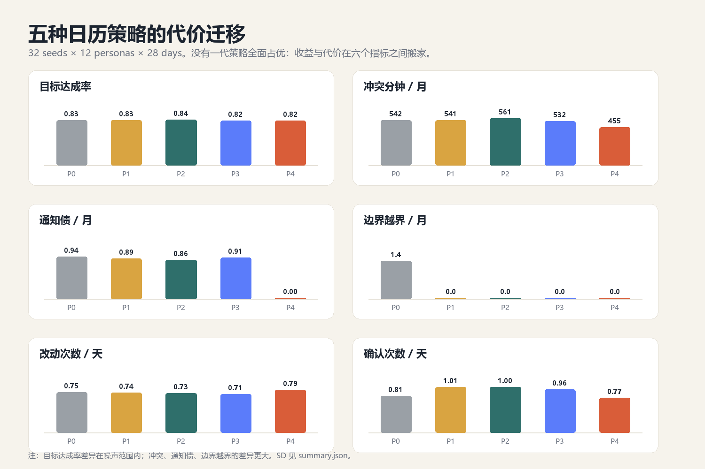
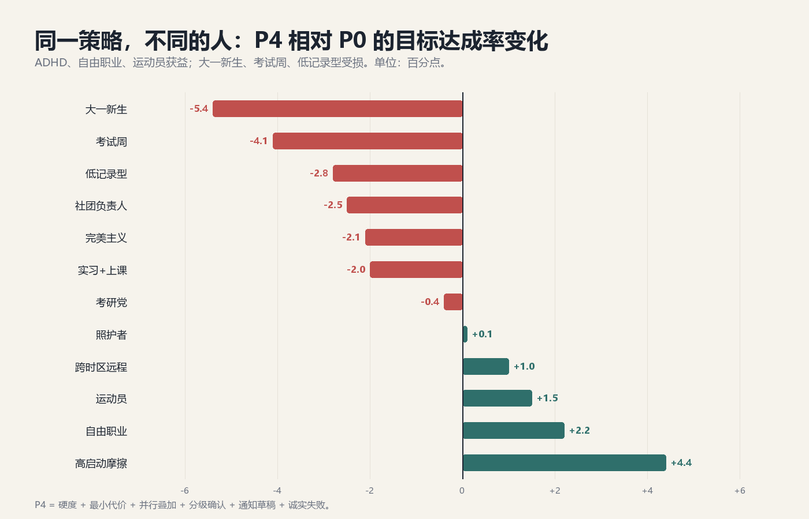
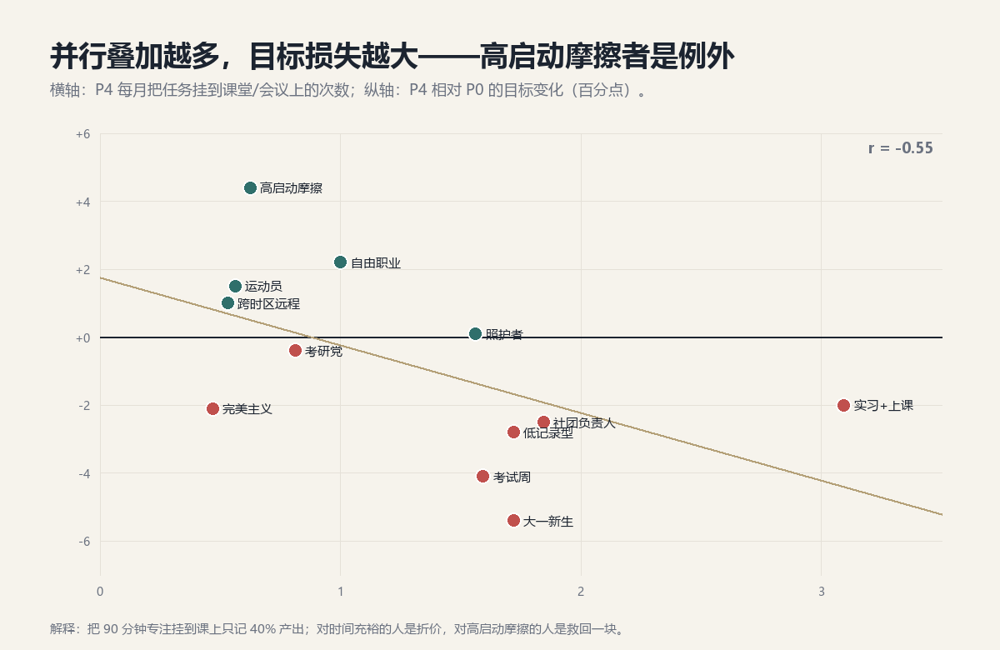

# 28 天压力模拟：灵活调整的代价去了哪里

> v0.2 / 2026-11-01 / 模拟实验，不是用户研究结论
> 关联：`日历灵活调整_用户需求全景_v0.1.md`、`sim/calendar_stress.py`
> 这次不延续"插会 / 切换 / 同时做两件事"的例子，而是让 12 类人、5 代策略在 28 天里自己跑，看系统在压力下先坏在哪里。

---

## 0 一页结论

**一句话**：灵活调整不创造时间，它只决定**代价由谁承担**——是用户多改几次、多答几次、多背几笔计划债，还是系统承认排不下。

六个反直觉发现：

1. **目标达成率几乎不随策略变化。** 五代策略的目标达成率只在 **0.82–0.84** 之间，差异约 2 个百分点；但冲突分钟相差 **19%**、确认次数相差 **31%**。策略真正改变的是代价的位置，不是时间的总量。
2. **"完整策略"不是全面升级。** P4 把冲突减少 **16%**、通知债清零（草稿），代价是改动 **+6%**、目标 **-1%**（在噪声范围内）。它是一个"冲突/通知专家"，不是"目标专家"。
3. **只加硬度、不加代价函数，是最不划算的一代。** P1 的确认次数比基线 **+24%**，目标只 **+0.3pp**，冲突几乎不变。更尊重用户的约束，如果没有更好的落位能力，只是把问题变成更多问题。
4. **并行叠加是贷款，不是免费时间。** 叠加次数与目标损失相关 **r = -0.55**；40% 折算下，叠得越多目标越低。例外是高启动摩擦人群：他们本来会整块丢失，叠上去反而 **+4.4pp**。
5. **同一策略对不同人是相反的。** P4 让高启动摩擦 **+4.4pp**、自由职业 **+2.2pp**，却让大一新生 **-5.4pp**、考试周 **-4.1pp**。没有"最佳策略"，只有"适合谁的策略"。
6. **一次生病 = 5.6 天恢复。** 第 9 天病倒一天，之后平均要 5.6 天才回到 80% 的日目标；所有策略的月末积压都在 **400 分钟**左右。调整策略只优化正常日，不负责恢复。

---

## 1 为什么换一种模拟

v0.1 做的是"用户会要求什么"：把需求按场景归类，回答**功能面**。但灵活调整的风险不在功能缺失，而在**运行一个月后的二阶效应**：

- 每次都能排下，但用户被问了 30 次；
- 每个冲突都解决了，但代价是动了 5 件不相关的事；
- 目标保住了，但周末被侵蚀、通知没发、待补越滚越多；
- 系统越"聪明"，用户越不再看日历，最后不知道哪件是真的。

这些问题不会出现在一次访谈里，只会出现在连续运行里。所以这次用**基于代理的压力模拟**：给 12 类人各一副"生活参数"，让五代策略在同一套中断流里跑 28 天，比较它们把代价放在了哪里。

---

## 2 实验设计

### 2.1 规模

- **12 类人 × 5 代策略 × 32 个随机种子 = 1,920 个"人-月"**，每人 28 天，每天 08:00–23:00、15 分钟粒度。
- 每人有：课程、会议、午餐/通勤/晚餐等软固定锚点、专注块、习惯、社交、带截止的任务。
- 每天约 2 次中断：临时插会、会议延长、取消、任务超时、截止提前、社交邀请、外部日历改动、状态下降。
- 第 9 天统一"病一天"，第 16 天统一插入外部会议，第 19 天统一提前截止，第 23 天统一社交邀请，保证跨策略可比。

### 2.2 五代策略

| 代号 | 名称 | 关键差异 |
| --- | --- | --- |
| **P0** | 基线：二元固定/可动 | 只有"固定/可动"，批量预览；所有非锁定事件都可被整体移动 |
| **P1** | 硬度光谱 | H0–H5；H0 不动，H1/H2 先问，H3+ 可移 |
| **P2** | +最小代价 | 加入改动条数、跨天、连续性、切换成本的代价函数；半径 3 天 |
| **P3** | +并行叠加 | 没有合适空位、或落位代价过高时，把专注/任务挂到低负荷课堂/会议上，按 40% 折算 |
| **P4** | 完整策略 | 分级确认（低成本不问）、每天 4 次改动预算、通知草稿、诚实失败 |

### 2.3 指标

- **目标达成率**：完成的专注分钟 / 四周目标（不含任务）。
- **冲突分钟/月**：未解决的日历重叠。
- **通知债/月**：涉及他人、被移动但没有通知草稿的事件数。
- **改动/天、确认/天、接受率**：调整的摩擦成本。
- **恢复天数**：病假后回到 80% 日目标所需天数。
- **月末积压**：所有任务剩余分钟。
- **叠加/月**：把任务挂到其他事件上的次数。

### 2.4 边界

这是**压力测试工具**，不是预测模型。参数是为产生对比而设的，40% 折算、接受率、中断频率都可以被质疑；结论应读作"在这组假设下，系统会先坏在哪里"，而不是"真实用户会怎样"。§13 给出敏感性与下一步。

---

## 3 结果一：没有全面赢家



| 指标 | P0 基线 | P1 硬度 | P2 +代价 | P3 +并行 | P4 完整 |
| --- | --- | --- | --- | --- | --- |
| 目标达成率 | 0.830 | 0.833 | **0.844** | 0.824 | 0.822 |
| 冲突分钟/月 | 542 | 541 | 561 | 532 | **455** |
| 通知债/月 | 0.94 | 0.89 | 0.87 | 0.91 | **0.00** |
| 边界越界/月 | 1.41 | 0 | 0 | 0 | 0 |
| 改动/天 | 0.75 | 0.74 | 0.73 | **0.71** | 0.79 |
| 确认/天 | 0.82 | 1.01 | 1.01 | 0.96 | **0.77** |
| 接受率 | 0.35 | 0.35 | 0.34 | 0.34 | 0.34 |
| 月末积压/分钟 | 403 | 403 | 405 | 409 | 409 |
| 恢复天数 | 5.6 | 5.8 | 5.6 | 5.6 | 5.8 |

**三个读法：**

1. **目标是一块几乎不动的天花板。** 所有策略都在 0.82–0.84；真正的差异在冲突（最高差 19%）、确认（最高差 31%）、改动（最高差 12%）。这说明"调整能力"不能创造时间，只能重新分配摩擦。
2. **P2 是目标最优，P4 是冲突/通知最优。** P2 用 +23% 的确认和 +3.6% 的冲突，换来 +1.4pp 目标；P4 用 +6% 的改动和 -1% 目标，换来 -16% 冲突和通知债清零。两者不是升级关系，是**不同的取舍**。
3. **P1 是"礼貌的停滞"。** 它把边界越界从 1.4 降到 0，但目标没涨、冲突没降、确认 +24%。它让系统更"守规矩"，却没有更"会安排"。

> **产品含义**：不要用"目标达成率"单独评估灵活调整；它太钝。应该同时看"每次调整的代价账单"：动了几件、问了几次、留下几个冲突、欠了几笔通知。

---

## 4 结果二：同一策略，相反的人



| 人群 | P0 | P2 | P4 | P4-P0 | 冲突 P0→P4 | 叠加/月 | 最优 |
| --- | --- | --- | --- | --- | --- | --- | --- |
| 大一新生 | **0.80** | 0.76 | 0.74 | -5.4pp | 607→541 | 1.7 | P0 |
| 考研党 | 0.95 | **0.96** | 0.95 | -0.4pp | 435→318 | 0.8 | P2 |
| 社团负责人 | 0.87 | 0.87 | 0.85 | -2.5pp | 652→569 | 1.8 | P1 |
| 实习+上课 | 0.76 | **0.81** | 0.74 | -2.0pp | 534→485 | 3.1 | P2 |
| 高启动摩擦 | 0.60 | 0.62 | **0.65** | **+4.4pp** | 588→485 | 0.6 | P4 |
| 完美主义 | 0.87 | **0.88** | 0.85 | -2.1pp | 626→512 | 0.5 | P2 |
| 跨时区远程 | 0.79 | **0.81** | 0.80 | +1.0pp | 410→337 | 0.5 | P2 |
| 照护者 | 0.87 | **0.91** | 0.88 | +0.1pp | 541→452 | 1.6 | P2 |
| 运动员 | 0.86 | 0.89 | 0.88 | +1.5pp | 561→434 | 0.6 | P3 |
| 自由职业 | 0.87 | **0.92** | 0.90 | +2.2pp | 472→410 | 1.0 | P2 |
| 低记录型 | **0.84** | 0.83 | 0.81 | -2.8pp | 583→507 | 1.7 | P0 |
| 考试周 | **0.87** | 0.86 | 0.83 | -4.1pp | 490→411 | 1.6 | P0 |

**谁获益、谁受损，有清晰的结构：**

- **获益：高启动摩擦、自由职业、运动员、跨时区。** 他们的共同点是"块一旦丢了就回不来"或"时间边界本来就模糊"。P4 的分级确认和通知草稿可能减少了他们的来回沟通，叠加把本来会丢的块救回一部分。
- **受损：大一新生、考试周、低记录型。** 他们的共同点是"计划密度高、容错低"或"数据少、校准差"。P4 多做的每一次移动，更容易把专注推到非高峰时段；叠加又把 90 分钟折成 36 分钟。对本来时间就紧的人，这是净损失。
- **P2 是六类人的目标最优解**（考研、实习、完美主义、跨时区、照护者、自由职业），P0 在三类人上仍最优（大一、低记录、考试周），P1 在社团负责人上最优，P3 在运动员上最高，P4 只在高启动摩擦这一类上最优。**没有全能策略，只有适配策略。**

> 注：人群差异是 32 个种子的点估计，部分差异可能落在噪声内；这里用来看方向，不用来做个体预测。

> **产品含义**：策略不应该做成"版本升级"，应该做成**按人配置的开关**。P2 做默认内核；通知草稿和分级确认作为所有人都受益的模块；叠加只对"块容易整块丢失"的人默认开启，其余人默认关闭。

### 4.1 为什么实习+上课被叠加反噬

实习+上课是 P4 叠加最多的人群（3.1 次/月），也是 P2 到 P4 掉得最多的人群之一（0.81→0.74；相对 P0 是 -2.0pp）。机制很直接：他有很多低负荷的课堂/会议，系统于是频繁把专注挂上去；每次挂载只记 40%，而如果他再找一个空位，本可以记 100%。**系统把"有地方放"误当成了"放得好"。**

### 4.2 为什么高启动摩擦是例外

高启动摩擦的 P0 目标只有 0.60，P4 是 0.65。他的问题不是"没有空位"，而是"有空位也起不来"。把任务挂到已经在发生的课堂上，启动成本接近零，40% 也比 0% 好。**对这类人，叠加不是折价，是救回。**

---

## 5 结果三：并行是贷款，不是时间



- P3/P4 平均每月叠加 **1.3 次**，带来约 **34 分钟**的折算产出。
- 叠加次数与 P4 相对 P0 的目标变化相关 **r = -0.55**：叠得越多，目标越低。
- 敏感性：把折算系数从 0.25 调到 0.60，P4 总体目标从 **0.818 → 0.836**，仍然没有超过 P2 的 0.844；对实习+上课，0.60 时回到 0.763，仍低于 P2 的 0.808。

**这不是说并行没用，而是说并行有汇率。**

- 90 分钟课堂挂 90 分钟作业，记 36 分钟，汇率 0.4；
- 如果这 90 分钟本来会被浪费，0.4 是净赚；
- 如果它挤掉了一个本可以 100% 的专注块，0.4 是净亏。

**产品规则**：叠加只应作为**兜底**（没有空位、块会整块丢失、用户主动要求），不应作为**优化器**（看到低负荷课堂就自动挂）。并且必须让用户校准汇率：同一节课，有人能写 60 分钟，有人只能写 15 分钟。

---

## 6 结果四：确认悖论

| 策略 | 确认/天 | 接受率 | 目标 |
| --- | --- | --- | --- |
| P0 | 0.82 | 0.35 | 0.830 |
| P1 | **1.01** | 0.35 | 0.833 |
| P4 | **0.77** | 0.34 | 0.822 |

- P1 比 P0 多问 **24%**，目标只多 **0.3pp**，冲突只少 **0.1%**。
- P4 比 P0 少问 **6%**，但接受率没有上升（0.335 vs 0.346）。原因是它问的更多是 H1/H2 的高代价问题，而用户对高代价问题的接受率本来就低。

**确认悖论**：问得越多，每一次问越不值钱；用户不是被说服的，是被磨烦的。真正减少打扰的不是"少问"，而是"只问那些问了会改变结果的问题"。

**产品规则**：

1. 低代价、可逆的改动：静默 + 10 秒撤销，不问。
2. 涉及他人、涉及截止、跨天的改动：必须问，且只问一次。
3. 同一件事不要二次确认；如果用户拒绝，记录原因，不要换个说法再问。
4. 每天设"打扰预算"（建议 ≤2 次主动打断），超出后进入摘要模式。

---

## 7 结果五：恢复期与计划债务

第 9 天统一病一天后：

- 平均 **5.6 天**才回到 80% 日目标；
- 月末积压约 **400 分钟**，五代策略没有差别；
- 任务截止错过约 **2 个/月**，也没有差别。

这说明：**调整策略优化的是"正常日"，不是"恢复期"。** 病一天不是少做一天，而是把接下来一周的排布打乱；系统越擅长"把事塞回去"，越容易在恢复期塞出二次崩溃。

**产品规则**：

1. 病假/状态差触发**恢复模式**：不是逐条重排，而是先做减法（本周目标下调、非紧急任务挂起）。
2. 设"最小可行周"：只保留 3 件事，其余进入待补池，不自动排。
3. 待补池要有**上限和豁免**：超过 N 小时就提示"放弃一些"，而不是无限滚动。
4. 恢复期不主动增加新建议，先让用户回到节奏。

---

## 8 二阶需求：模拟跑出来的 8 条

> 这些不是用户一开始会提的，是系统运行一段时间后才会浮现的需求。编号接 v0.1 的 N10。

| 编号 | 需求 | 模拟证据 | 产品动作 | 优先级 |
| --- | --- | --- | --- | --- |
| **N11** | 改动预算与稳定模式 | P4 改动 +6%，每天预算 4 次几乎从不触发 | 周改动预算、稳定模式、改动前显示"这会动几件" | P0 |
| **N12** | 计划债务台账 | 月末积压约 400 分钟，五代无差别 | 待补池上限、债务周报、"放弃一些"仪式 | P0 |
| **N13** | 确认预算与打扰账本 | 确认 0.77–1.01/天，接受率仅 0.34 | 每天 ≤2 次主动打断；低代价静默；拒绝后不换说法再问 | P0 |
| **N14** | 硬度通胀治理 | P1 整体提问 +24%、目标只 +0.3pp、冲突 -0.1%；高硬度人群可动空间更小 | 显示"全硬=不能调"；硬度体检；建议降级而非替用户改 | P1 |
| **N15** | 并行折算校准 | r=-0.55；40% 折算下叠加越多目标越低；ADHD 例外 | 叠加只做兜底；按人/按课校准汇率；默认关闭 | P0 |
| **N16** | 通知债台账 | P0–P3 每月约 0.9 笔未通知；只有 P4 清零 | "对方还不知道"徽标；批量发送；发送前确认 | P1 |
| **N17** | 恢复模式/最小可行周 | 病假后 5.6 天恢复；积压 400 分钟 | 整段降级、目标下调、待补封顶、恢复期不新增建议 | P0 |
| **N18** | 锁死审计与解锁建议 | 无解 0.4–0.7 次/月；越焦虑越锁 | 显示"是哪把锁挡住了"；给出可解锁项；不静默违规 | P1 |

### 8.1 第二轮用户原话：这 8 条需求会怎么被说出来

| 用户会怎么说 | 指向 | 设计动作 |
| --- | --- | --- |
| 这周已经改了六次了，能不能先别动，等我缓一下。 | N11 | 周改动预算 + "稳定到周末" |
| 你就为了塞一个 30 分钟的会，把我整个下午都挪了？ | N11 | 改动前显示"动几件、动哪几件" |
| 下次改之前告诉我动了几件，别只说"已优化"。 | N11 | 代价账单放在第一行 |
| 待补的越来越多，我是不是该放弃一些？ | N12 | 债务上限 + 主动建议"放弃" |
| 上周没做完的，怎么全滚到这周了？ | N12 | 周初债务结转提醒 |
| 别每次都问我，问到最后我都随便点了。 | N13 | 低代价静默 + 撤销 |
| 我拒绝不是不同意，是我今天不想做决定。 | N13 | 拒绝后不追问，记录"暂时不动" |
| 同一件事你问两遍，我会觉得你没在听。 | N13 | 一事一确认，禁止换说法再问 |
| 我全标了必须去，你怎么不早说这样就没法调了？ | N14 | 硬度体检 + "全硬=不能调"提示 |
| 这个也必须去，那个也必须去，那你让我选一个？ | N14 | 不替用户排序，给取舍后果 |
| 上课写的作业，你算我 40% 是什么意思？ | N15 | 折算规则可见、可改 |
| 我在水课上能写 60 分钟，不是 36 分钟。 | N15 | 按课/按人校准汇率 |
| 两件都要动脑的事，别给我排一起。 | N15 | 认知负荷冲突检测 |
| 你改了时间，但对方还没收到通知，这算改了吗？ | N16 | 通知债徽标 + 未发送状态 |
| 别替我拒绝别人，帮我写句话就行。 | N16 | 只起草，不发送 |
| 我病了一天，你至于把下周也重排吗？ | N17 | 恢复模式，不跨周重排 |
| 回来看到 20 个待补，我直接不想开始了。 | N17 | 待补封顶 + 最小可行周 |
| 我锁了为什么还动？ | N18 | 锁定绝对，冲突显式保留 |
| 我越锁越排不下，是不是该放开一些？ | N18 | 锁死审计 + 解锁建议 |

**这 8 条的共同点**：它们都不是"让 AI 更会排"，而是"让 AI 更会停、更会算账、更会承认"。

---

## 9 对抗性模拟：用户会怎么"玩坏"它

| 模式 | 用户会怎么做 | 系统风险 | 设计对策 |
| --- | --- | --- | --- |
| **约束通胀** | 把所有事标成"必须去" | 系统无解，或偷偷违规 | 显示"全硬=没有可调空间"；硬度体检；建议降级，不替用户改 |
| **完成虚报** | 没做也点完成，让目标好看 | 目标失真，复盘失效 | 部分完成/实际时长；异常检测；不把"点了完成"当成果 |
| **日历当待办** | 把 30 个小任务全塞进日历 | 事件膨胀，排布碎片化 | 任务池与日历分离；批量分诊；碎片槽限长 |
| **全面拒斥** | 连续拒绝所有建议 | 系统停摆，用户回到手工 | 接受率连续两周 <15% 时切换"少建议/手动模式"，而不是加更多建议 |
| **代理越权** | 让 AI 替自己拒绝/通知别人 | 社交后果由用户承担 | 只起草不发送；发送前必须用户点；保留"未发送"状态 |
| **防御性日历** | 用假忙碌块挡会、隐藏真实安排 | 共享日历失真，协作方不信任 | 私密忙碌块；只共享忙闲；不把私密块计入团队可见 |
| **多日历套利** | 工作/个人/小号日历各一套 | 冲突被隐藏，AI 看到的是残缺真相 | 冲突显式暴露；不静默合并；让用户决定哪本是真相 |

**对抗性模拟的结论**：用户不是恶意的，他们只是在**保护自己的时间**。产品要做的不是防作弊，而是让"保护"有一个不伤害系统的出口。

---

## 10 潜在需求：用户不会说，但会离开

1. **被允许不优化。** 模拟里目标只有 0.83，积压 400 分钟；继续加块并不会让目标更高。用户需要一个"这周就这样"的按钮，而不是永远被建议"再塞一块"。
2. **不被评价。** 接受率只有 0.34，很多拒绝不是不同意，是累了。文案不能说"你又拒绝了"，要说"这次先不动"。
3. **知道系统不知道。** 无解 0.4–0.7 次/月；用户能接受"排不下"，不能接受"假装排下了"。
4. **手动 override 的尊严。** 用户拖动一次，系统就不该挪回去；锁定不是建议，是边界。
5. **结束一天的仪式。** 晚上 9 点后不再新增建议，给一个"今天到此为止"的收尾；否则用户会在睡前被安排明天。
6. **记住"为什么"。** 用户需要知道上周为什么改了、谁改的、现在还算不算数；变更日志不是审计功能，是信任功能。

---

## 11 未来模拟：当每个日历都有一个 Agent

这是推测，不是实验，但值得提前想：

- **Agent 对 Agent 协商**：我的 Agent 问你的 Agent "周三下午能不能换到周四"，需要授权范围、身份、审计、拒绝权。否则就是两个自动系统互相踢皮球。
- **群体排程**：四个人找时间，不是"查空闲"那么简单；需要偏好聚合、优先级披露、谁可以让步。
- **日历防火墙**：Agent 只在一个"可协商区间"里代表我，区间外一律拒绝；这比"全权代理"更可信。
- **注意力预算**：把"今天还能做几件深的事"作为一个可交易/可保护的预算，而不是无限接受插入。

对应的新需求：**授权协议、代理身份、审计轨迹、拒绝权、注意力预算**。这些在 v0.1 里完全没有，因为它们是"多个 Agent 共存"之后才出现的问题。

---

## 12 对 v0.1 的修正

| v0.1 的说法 | 模拟后的修正 |
| --- | --- |
| 最小改动 | 改成"**最小可接受改动**"：有时多动一件反而少一个冲突；关键是让用户看到代价，而不是盲目少动 |
| 并行叠加 | 从"默认能力"降为"**兜底能力**"：默认关闭，只在块会整块丢失、用户主动要求、或高启动摩擦人群上开启 |
| 确认分级 | 分级本身不够；**H1/H2 的社交确认**才是打扰大头。通知草稿和"只问一次"必须一起做 |
| 诚实失败 | 支持，但真正的失败不是"排不下"，是"**静默欠债**"：通知没发、待补滚存、完成虚报 |
| 目标达成率 | 不作为唯一指标；加入**改动条数、确认次数、冲突残留、通知债、积压**五项代价 |
| 记录与反思 | 增加"**计划债务**"和"**恢复模式**"两个一等公民，而不是复盘页里的一个数字 |

**产品建议：不要直接发布 P4，发布一个"策略组合器"。**

- 默认内核：P2（硬度 + 最小代价）。
- 默认开启：P4 的分级确认 + 通知草稿（低成本、普适收益）。
- 默认关闭：叠加。仅对高启动摩擦/低 adherence 人群开启，且每天最多 1 次、必须用户确认。
- 独立模块：恢复模式、债务台账、锁死审计。

---

## 13 局限与下一步

**局限：**

- 合成人格、合成中断流，不是真实用户；参数（40% 折算、接受率、中断频率）会显著影响数值。
- 没有真实多人日历、没有学习、没有时区/DST、没有跨设备同步。
- 目标只算专注分钟，没有算成果质量；"完成"是概率模型，不是真实行为。
- 32 个种子只能说明方向，不能给出置信区间；目标差异在噪声范围内。

**下一步：**

1. 用 5–8 个真实学生做 7 天日记 + 一次回调访谈，校准三类参数：接受率、叠加汇率、恢复时间。
2. 在 Demo 里做 A/B：P2 vs P4，观察"改动条数/确认次数/撤销率"，而不是只看目标。
3. 把"全锁死"和"生病恢复"做成两个可演的失败剧本，验证用户是否真的更信任"承认排不下"的系统。
4. 如果要做多人日历，先做"通知债"和"可见性"，不要先做自动协商。

---

## 附录 A 复现

```bash
python sim/calendar_stress.py   # 12 personas × 5 policies × 32 seeds
python sim/analyze.py           # 人群 × 策略表
python sim/charts.py            # 三张图
python sim/sensitivity.py       # 叠加折算 0.25 / 0.40 / 0.60
```

输出：`sim/out/runs.json`、`summary.json`、`summary.csv`、`persona_summary.csv`、三张 PNG。

## 附录 B 指标定义

| 指标 | 定义 |
| --- | --- |
| 目标达成率 | 完成的专注分钟 / 四周目标，封顶 1.0 |
| 冲突分钟 | 未解决的重叠时长，按 15 分钟槽累计 |
| 通知债 | 涉及他人、被移动但没有通知草稿的事件数 |
| 改动/天 | 移动、缩短、删除的总次数 / 28；叠加单列，不混入改动 |
| 确认/天 | 向用户发起的确认次数 / 28 |
| 接受率 | 接受的确认 / 总确认 |
| 恢复天数 | 病假后连续达到 80% 日目标所需天数，封顶 10 |
| 月末积压 | 所有任务剩余分钟之和 |
| 叠加/月 | 把专注/任务挂到课堂/会议上的次数 |
