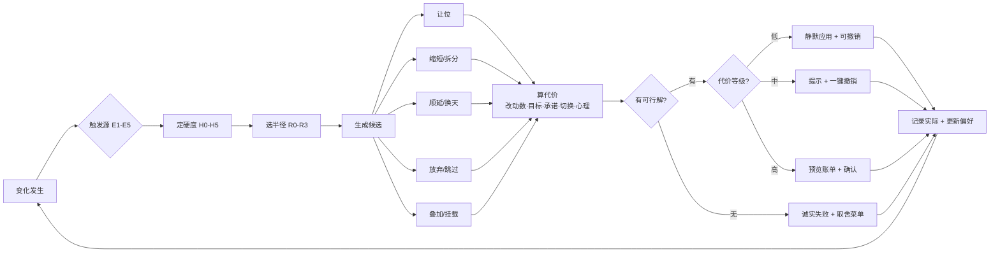

# 日历灵活调整 · 用户需求全景

> 模拟用户研究 / v0.1 / 2026-11-01
> 后续压力模拟：`日历灵活调整_压力模拟与二阶需求_v0.2.md`（12 类人 × 5 代策略 × 28 天）
> 对应闭环环节：**用户执行与反馈 · 变化可触发局部调整**
> 关联材料：`01-product-loop.html`、Reclaim 日历调整 Demo（`index.html`）、`用户画像类型与排布策略.md`

**怎么读**：时间紧只看 §0、§5、§10；要做界面看 §4、§6、§7；要防守评审看 §8、§11。

---

## 0 一页结论

**一句话**：用户要的不是"AI 帮我重排"，而是"在尽量少动我生活的前提下，帮我把这次变化消化掉，并且让我看得懂、退得回"。

1. **优化目标不是"塞得下"，是"改得少"。** 全局最优会把用户熟悉的一天整体重写，用户感知到的不是智能，是失控。
2. **优先级不等于硬度。** 标成高优先级的专注块也可能可以挪，标成低优先级的"接孩子"却不能挪。现在的 P1–P4 是一维的，真实世界至少是"硬度 × 优先级 × 可补性"三维。
3. **同时做两件事不是异常，是常态。** 上课写作业、开会记纪要、通勤听播客、陪家人回消息——日历的"占用/不占用"二元模型在这里完全失真，需要"独占 / 主辅 / 背景"三态。
4. **确认次数要跟代价走。** 每件小事都弹窗是打扰，什么都不问是失控。低代价静默加可撤销，高代价必须预览，一次调整只问一次。
5. **解释不是文案，是约束的回放。** "为什么排 15:00"最好的答案不是"AI 优化后更合理"，而是"你设了 12–14 点午休，15:00 是今天唯一连续 60 分钟的空位"。

### 用户嘴上说的 vs 真正要的

| 用户会说 | 真正要的 | 产品该给的 |
| --- | --- | --- |
| "帮我挪一下" | 最小改动，不要连锁 | 只动必要事件 + 一份 diff |
| "这个重要，别动" | 硬度声明权 | 一键锁定 / 冻结，AI 不得覆盖 |
| "你看着办" | 委托，但保留知情和反悔 | 自动选代价最小方案 + 事后一句摘要 + 撤销 |
| "我在上课，帮我排作业" | 并行，不是二选一 | 主辅叠加 + 折算计时 |
| "为什么动它" | 可验证的理由 | 引用用户自己设的约束 |
| "排不下怎么办" | 诚实降级，不要硬塞 | 取舍菜单：缩短 / 拆分 / 换天 / 放弃 |
| "别老问我" | 确认分级 | 低风险静默可撤销，高风险才预览 |
| "我没做完" | 事实与计划分离 | 部分完成、剩余待补，不二元判定 |

---

## 1 这份文档怎么来的

**方法**：用现有 8 类画像（P1–P8）× 5 类变化触发源 × 6 种情境（校园 / 职场 / 自由职业 / 家庭 / 跨时区 / 异常日）组合出 48 个模拟用户，每人写 3 篇"变化日记"：发生了什么 → 第一反应 → 希望系统做什么 → 绝对不能接受什么。把 144 条日记归并去重，得到 **10 类 / 84 条**需求。

**标注**：

- **P0**：不做则能力不成立或会伤信任的"底线条件"。多数是约束、状态和文案，不是 36 个新界面。
- **P1**：显著提升可用性的核心体验。
- **P2**：场景扩展，本期可不做。
- **Demo**：★★ 纯前端规则可演；★ 需要 mock 数据或额外状态；☆ 需要真实集成，本期不演。

**边界**：这是**结构化模拟推演**，不是统计结论，也不是真实访谈。它的用途是生成假设、写 Demo 剧本、准备评审问答；上线前仍需 5–8 人真实访谈验证（见 §12）。

**与现有红线的关系**：本文件默认遵守 `用户画像类型与排布策略.md` 的 R1–R9（只给草案、不推断健康、未记录不等于 0、不自动改期限等）。少数用户诉求与红线冲突，集中在附录 A，不在这里偷偷放宽。

---

## 2 五个反直觉判断

### 2.1 用户感知的"智能"= 改动量小 + 理由清楚

排程算法追求全局最优，用户追求局部稳定。一个把所有事件重新洗牌、但目标达成率更高的方案，会被评价为"它把我的生活搞乱了"。所以代价函数的第一项必须是**改动条数**，其次才是目标损失。

### 2.2 事件的"硬度"比"优先级"更接近用户的真实分类

用户不会说"这件事是 P2"，用户会说"这个必须去""这个可以请假""这个不做也行""这个晚点做没事"。这是几种不同的**可违约程度**，不是重要程度。一个不重要的会也可能不能缺席（点名），一个重要的专注也可能随时可以让位（自己的事）。

### 2.3 并行需要新的时间语义

同一段时间可以同时承载：到场（低认知）、产出（高认知）、背景（听/看）。现在日历把三者都记成"忙"，导致两个后果：要么不敢排（上课时间全废），要么虚增（通勤听播客算一小时学习）。产品必须允许用户声明"谁是主、谁是辅、各算多少"。

### 2.4 确认的成本是不对称的

多问一次的成本是"烦"，少问一次的成本是"我的日历被改了"。后者严重得多。所以默认应该偏保守，但**保守不等于每次都弹窗**：低代价变更可以静默 + 显眼撤销，高代价变更必须预览。确认的粒度应该由"涉及几个人、有没有截止、动了几个块"决定。

### 2.5 失败路径决定信任

用户真正记住的不是"它帮我排好了"，而是"它排不下的时候有没有骗我"。找不到位置时硬塞、静默删块、假装通知了对方、把没做标成完成——这四件事任何一件发生，产品就失去信任。所以"诚实失败"是 P0，不是边缘情况。

---

## 3 变化从哪来：五类触发源

| 类型 | 典型例子 | 用户第一反应 | 系统第一个动作 |
| --- | --- | --- | --- |
| **E1 外部强插** | 老板拉会、客户改期、老师调课、朋友约饭、家人急诊 | "我得去，别的你看着办" | 判断新事件硬度，算影响，给方案 |
| **E2 内部漂移** | 做不完、做过头、开始晚了、提前完成 | "计划赶不上变化" | 重算今天剩余，保留已投入 |
| **E3 状态变化** | 累、困、病、情绪差、天气、设备坏 | "今天不在状态" | 提供整段降级，不逐条拷问 |
| **E4 意愿变化** | 不想做、想换一件、想休息、优先级变了 | "我突然不想按计划来" | 允许切换/放弃，记录原因 |
| **E5 结构变化** | DDL 改、考试周、出差、时区、开学放假 | "整张表都变了" | 切换排布模式，批量重算 |

**设计含义**：五类触发源对应五种不同的默认半径和确认级别。E1 默认"今天 + 预览"，E2 默认"今天剩余 + 静默可撤销"，E3 默认"整段 + 只问一次"，E4 默认"本次 + 不问"，E5 默认"整周 + 预览"。现在 Demo 只有 E1，其余四类都没有入口。

---

## 4 三个核心模型

### 4.1 硬度光谱 H0–H5

| 级别 | 名称 | 判定标准 | 例子 | AI 能做什么 |
| --- | --- | --- | --- | --- |
| **H0** | 不可动 | 不可替代、不可缺席，或变更会造成硬后果 | 面试、考试、接孩子、手术、航班 | 绝不移动，冲突显式保留 |
| **H1** | 对外承诺 | 可改，但必须先协商并通知 | 客户会、1:1、组会、约会 | 只能建议 + 生成询问话术 |
| **H2** | 软固定 | 可请假/可缺席，但有代价 | 水课、例会、团课、社团活动 | 可提议让位，需用户确认 |
| **H3** | 可移动 | 时间自由，时长固定 | 专注块、任务块、习惯 | 可直接重排（预览后） |
| **H4** | 可伸缩 | 可缩短、可拆分 | 阅读、整理、练习、复盘 | 优先缩短/拆分而非移动 |
| **H5** | 可放弃 | 本次不做也没有后果 | 可选任务、锦上添花 | 最后才牺牲，且告知 |

**三条规则**：

1. **硬度与优先级正交。** "重要"回答"值不值得做"，"硬度"回答"能不能动"。两者都高 = 既重要又不能动；两者都低 = 最佳让位对象。
2. **默认值必须保守且可改。** 外部日历来的事件默认 H1，自建任务默认 H3，习惯默认 H4，用户手动锁定 = H0。默认值只影响第一次提议，用户一键可改。
3. **H1 是现在最大的空洞。** 真实世界里大量事件是"可以改，但要先问一下"。系统现在只有"固定/可动"二元，于是要么不敢动，要么直接动——两种都错。H1 需要的是"建议 + 话术 + 待确认"，不是自动改。

### 4.2 注意力叠加模型

| 模式 | 定义 | 时间计入 | 例子 | 冲突规则 |
| --- | --- | --- | --- | --- |
| **独占** | 占满注意力，不能同时做别的 | 1.0 | 考试、面试、深度写作、开车 | 与任何事件重叠都算冲突 |
| **主任务** | 人在场是主要目的，产出是次要 | 1.0（到场） | 上课、开会、陪家人吃饭 | 可挂副任务，本身不可被覆盖 |
| **副任务** | 挂在主任务下的低负荷产出 | 0.3–0.5 | 水课写作业、开会记纪要 | 负荷必须低于主任务 |
| **背景** | 不需要专门占日历的伴随时间 | 0.2–0.3 | 通勤听播客、家务听书、散步复盘 | 不单独占位，可挂在通勤/家务上 |
| **可中断** | 随时被打断，可填充碎片 | 按实际 | 排队、等洗衣、等人 | 只接 ≤15 分钟任务 |

**四条规则**：

1. 两个高认知任务不能叠加（写代码 + 写论文 = 假叠加）。
2. 涉及他人的在场默认独占（陪客户吃饭时不该被排任务）。
3. 叠加必须由用户声明，系统不自动假设"你在摸鱼"。
4. 记录只记增量，不重复计入目标（副任务 50 分钟 × 0.4 = 20 分钟，而不是 50 分钟）。

### 4.3 调整代价函数与半径

用户眼里的"损失"由五项构成，好的调整是总代价最小，而不是排得最满：

| 代价 | 含义 | 用户会怎么说 |
| --- | --- | --- |
| **目标损失** | 周目标/截止风险变大 | "这周专注只剩 3 小时了" |
| **连续性损失** | 固定时段、连续块、习惯链被打断 | "别把我的专注拆成四段" |
| **承诺损失** | 影响他人时间、信誉 | "你改了我的会，对方知道吗" |
| **切换损失** | 通勤、准备、恢复、重新进入状态 | "会之间给我留 10 分钟" |
| **心理损失** | 失控感、内疚、决策疲劳 | "这周已经改了四次了" |

**调整半径**（默认取最小）：

- **R0 本次**：只处理这一件事，不动其他。
- **R1 今天**：重排今天剩余，昨天和明天不动。
- **R2 本周**：允许跨天，但不动下周。
- **R3 到截止**：围绕一个目标/DDL 整体重排。

**四种降级**：缩短 → 拆分 → 顺延 → 放弃。顺序不是固定的：临近截止时"缩短"优先，习惯类"顺延"优先，社交类"放弃并告知"优先。

### 4.4 一次调整的决策流水线

**读法**：任何一次"日历要变"，都应该走完这条线。现在 Demo 只覆盖了 A→B（E1）→C（部分）→E→K→P→R 的一条窄路径；缺的是 E2–E5 的入口、H1/H2 的中间态、J 的叠加分支，以及 L→Q 的失败分支。

---

## 5 需求分类总览

| 编号 | 类别 | 一句话 | 条数 | P0 |
| --- | --- | --- | --- | --- |
| **N1** | 突变插入与让位 | 新事件进来时，先算影响再动手 | 8 | 5 |
| **N2** | 进行中切换与中断 | 计划执行到一半变了，怎么接住 | 10 | 5 |
| **N3** | 并行与叠加 | 同一段时间做两件事，怎么算 | 7 | 3 |
| **N4** | 重要性与硬度判定 | 什么能动、什么不能动、谁说了算 | 9 | 6 |
| **N5** | 调整策略与代价 | 怎么调最省、最少、最稳 | 10 | 4 |
| **N6** | 控制权与确认 | 什么时候问、问几次、能不能退 | 9 | 5 |
| **N7** | 解释与信任 | 为什么这么改、改了什么、谁改的 | 7 | 3 |
| **N8** | 沟通与协作 | 改动涉及别人时怎么办 | 7 | 1 |
| **N9** | 记录、反思与目标 | 计划之外的真实发生怎么记 | 9 | 2 |
| **N10** | 边界、异常与隐私 | 排不下、全锁死、生病、时区 | 8 | 2 |

> 合计 **84 条**：P0 36 条、P1 40 条、P2 8 条。注意：P0 里大部分是**约束、状态和文案**，不是 36 个界面；真正的核心新交互约 8 个（见 §10）。另有 6 条校园场景特化，见附录 B，不计入主干。

---

## 6 需求清单

### N1 突变插入与让位（8）

| 编号 | 用户会怎么说 | 底层需求 | 产品应做 | Demo | 优先级 |
| --- | --- | --- | --- | --- | --- |
| N1-01 | 老板三点拉了个会，我今天的专注是不是没了？ | 插入后先算影响，不自动牺牲目标 | 插入预览显示：影响几个块、周目标 6h→5h、能否补回；给接受/换方案 | ★★ | P0 |
| N1-02 | 这个会必须去，别动它，动别的。 | 新事件默认硬，但可一键降级 | 新建时选"必须到场/可协商/可缺席"；默认外部 H1、自建 H3 | ★★ | P0 |
| N1-03 | 就加个 30 分钟的会，别把我一整天都重排了。 | 最小调整半径 | 只解冲突、不做全局优化；diff 只列必要改动 | ★★ | P0 |
| N1-04 | 下午要出去两小时，帮我空出来。 | 用"一段时间"表达占用，而不是一个事件 | 快速占位块，支持无标题、私密、不可见 | ★★ | P1 |
| N1-05 | 别把这个会排在我接孩子的时间上。 | 个人硬约束优先于工作事件 | 个人固定块 H0，跨日历生效，AI 不得覆盖 | ★★ | P0 |
| N1-06 | 这个会可去可不去，你看着办。 | 委托决策，但保留知情和反悔 | "你决定"模式：选代价最小方案，事后一句摘要 + 撤销 | ★ | P1 |
| N1-07 | 临时加的事和我原来的事撞了，给我几个选择。 | 要选项，不要结论 | A/B/C 方案卡：让位/缩短/换天/放弃，每张标代价 | ★★ | P0 |
| N1-08 | 我加错时间了，改一下，别引发连锁。 | 修正输入不应被当成新冲突 | 编辑事件保留原调度意图，仅重算受影响部分 | ★★ | P1 |

**设计判断**：插入是最高频的入口，也是用户第一次判断"这个 AI 靠不靠谱"的时刻。预览里必须同时出现三样东西：**动了谁、目标差多少、有没有更好的方案**。只显示"已为你重新安排"等于什么都没说。

### N2 进行中切换与中断（10）

| 编号 | 用户会怎么说 | 底层需求 | 产品应做 | Demo | 优先级 |
| --- | --- | --- | --- | --- | --- |
| N2-01 | 这会开了 40 分钟还没完，后面怎么办？ | 实时顺延，而不是等结束再重排 | 进行中"延长 15/30/60"，立刻预览顺延项和冲突 | ★★ | P0 |
| N2-02 | 我想先做另一件，刚才那件怎么办？ | 切换要保留已投入，不惩罚 | "切换"：记录已做时长，剩余顺延或拆分，不重置进度 | ★★ | P0 |
| N2-03 | 我迟到了 20 分钟，后面还按原计划吗？ | 现实偏移要重算，不是责备 | "我晚了 X 分钟" → 重排今天剩余，必要时通知对方 | ★ | P1 |
| N2-04 | 我提前做完了，空出来的时间干点啥？ | 正向变化也要利用 | 空档推荐：推进目标 / 休息 / 提前做下一件 | ★★ | P1 |
| N2-05 | 做到一半被打断，回来找不到状态。 | 保护连续性，留下"接续点" | 中断时记录进度和下一步，恢复块带上下文 | ★ | P1 |
| N2-06 | 这节水课我坐后排，能干点别的吗？ | 低强度在场时间可承载副任务 | 事件挂载副任务，按负荷折扣计入 | ★★ | P0 |
| N2-07 | 我今天状态很差，后面全不想做了。 | 允许整段放弃而不崩盘 | "今天到此为止"：剩余顺延、保周目标、不连环追问 | ★★ | P0 |
| N2-08 | 临时被叫走，我的专注块别直接删。 | 中断不等于取消，要保留再安排 | 被挤掉的块进入"待补"池，不静默消失 | ★★ | P0 |
| N2-09 | 会取消了，空出来的一小时别浪费。 | 负向变化也要回填 | 取消后推荐补块或休息，不擅自改其他事件 | ★★ | P1 |
| N2-10 | 下雨堵车，我赶不上了。 | 通勤与迟到是常态 | 通勤缓冲、迟到重算、线上替代建议 | ★ | P2 |

**设计判断**：现在的日历假设"事件按计划开始和结束"，真实生活不是。进行中操作（延长/切换/放弃）应该像播放器的暂停键一样随时可按，而不是先退出再编辑。用户最怕的是"我中途变了，系统当我没发生"。

### N3 并行与叠加（7）

| 编号 | 用户会怎么说 | 底层需求 | 产品应做 | Demo | 优先级 |
| --- | --- | --- | --- | --- | --- |
| N3-01 | 上课的时候我想写专业课作业，怎么排？ | 主辅叠加，时间按比例计 | 事件"挂载"副任务；主任务记出勤，副任务记进度 | ★★ | P0 |
| N3-02 | 开会时只能做不用脑的活，别给我排写代码。 | 叠加要匹配认知负荷 | 副任务分机械/轻思考/深度，不匹配则拒绝并说明 | ★★ | P1 |
| N3-03 | 通勤 40 分钟听播客，算学习吗？ | 背景时间要能被承认，但不虚增 | 背景模式按 0.2–0.3 计入，标明"听/看/做" | ★ | P1 |
| N3-04 | 我一边陪家人一边回消息，别把这段算成工作时间。 | 社交在场是主任务，不能双重计入 | 叠加需声明主副；主任务全额，副任务折扣 | ★★ | P1 |
| N3-05 | 两件都要动脑的事别排一起，我会崩。 | 认知冲突检测 | 同为高负荷的叠加给出警告或阻止 | ★★ | P0 |
| N3-06 | 这个会我必须全程在场，不能干别的。 | 有些叠加是假叠加 | 事件级"不可叠加"标记，会议/考试/面试默认开启 | ★★ | P0 |
| N3-07 | 同时做两件事时，别让我填两份记录。 | 记录要轻 | 一次记录同时更新主副进度，副任务只记增量 | ★ | P1 |

**设计判断**：并行不是"允许日历重叠"这么简单，它改变了时间的计量单位。产品必须回答三个问题：**谁是主、副任务算多少、什么时候不允许叠**。答不上来，用户就会用"删掉一个"来绕过，目标进度反而失真。

### N4 重要性与硬度判定（9）

| 编号 | 用户会怎么说 | 底层需求 | 产品应做 | Demo | 优先级 |
| --- | --- | --- | --- | --- | --- |
| N4-01 | 你凭什么觉得我的健身不重要？ | 重要性由用户定义，不由 AI 猜 | 事件可写一句"为什么重要"，AI 只引用不复判 | ★★ | P0 |
| N4-02 | 这个是 P1，那个也是 P1，到底动哪个？ | 优先级不能只有一维 | 硬度 + 优先级 + 可补性三轴；冲突时按可补性排序 | ★★ | P0 |
| N4-03 | 这个会我可以请假，但得先跟人说一声。 | 存在"可协商"的中间态，不是非黑即白 | H1 只建议 + 生成询问话术；H2 可提议让位但需用户确认 | ★★ | P0 |
| N4-04 | 别动我早上 9 点那件事，其他随便。 | 局部冻结 | 事件/时段/整天冻结，冻结优先于一切优化 | ★★ | P0 |
| N4-05 | 这节课必须到，但听不听无所谓。 | 出勤与投入分离 | 事件有"到场要求"和"投入要求"两个字段 | ★ | P1 |
| N4-06 | DDL 是周五，但周五下午交不进去。 | 截止时间有提交缓冲 | 截止前留 buffer，不排到最后一刻 | ★ | P1 |
| N4-07 | 这事今天不做没事，但这周必须做。 | 弹性期限 vs 硬期限 | 截止类型：硬日期/本周内/无期限，策略不同 | ★★ | P0 |
| N4-08 | 我标了重要，你还给我排到晚上 11 点？ | 重要的事要配好时段，不只是有空位 | 重要性影响时段质量，不只看空闲 | ★ | P1 |
| N4-09 | 周末和晚上别给我排事。 | 时间边界是硬约束 | 可排时段、免打扰、假期模式；越界必须确认 | ★★ | P0 |

**设计判断**：这是整个能力的地基。用户第一次看到"硬度"这个词可能不懂，但一问"这件事能不能动"就懂。界面语言不要用 H0–H5，用**必须去 / 要商量 / 可以挪 / 可以减 / 可以不做**五档，并允许一句话备注。

### N5 调整策略与代价（10）

| 编号 | 用户会怎么说 | 底层需求 | 产品应做 | Demo | 优先级 |
| --- | --- | --- | --- | --- | --- |
| N5-01 | 能不能只动下午的，上午别碰？ | 调整范围可控 | 半径选择"本次/今天/本周"；支持区域排除 | ★★ | P0 |
| N5-02 | 你动了 5 件事，其实动 1 件就够了。 | 最小改动原则 | 代价函数先比改动条数，再比目标损失 | ★★ | P0 |
| N5-03 | 别把我的专注拆成四段 20 分钟。 | 保护块完整性 | 最短块长约束、拆分割阈值 | ★★ | P0 |
| N5-04 | 会议之间给我留 10 分钟，别卡点。 | 切换和缓冲是刚需 | 会后/通勤/准备缓冲，可配置 | ★★ | P0 |
| N5-05 | 别把我排满，我需要喘气。 | 留白是功能不是浪费 | 日最大占用率、空白保护 | ★★ | P1 |
| N5-06 | 这周已经改了四次，能不能稳一点？ | 稳定性本身是目标 | 改动预算/冷却期，超过阈值先问 | ★ | P1 |
| N5-07 | 把这事挪到离 DDL 近一点，别现在就做。 | 时间位置有策略含义 | 按期限倒排，不一律"尽早塞" | ★ | P1 |
| N5-08 | 同一件事每天同一时间，别今天上午明天下午。 | 习惯的稳定性 | 固定时段偏好，漂移惩罚 | ★ | P1 |
| N5-09 | 碎片时间只能做小事，别塞大任务。 | 时间质量匹配任务颗粒 | 碎片槽只接 ≤30 分钟任务 | ★★ | P1 |
| N5-10 | 这件事得先做完那件，别排反了。 | 任务有依赖顺序 | 前后置约束，不逆序排 | ★ | P2 |

**设计判断**：用户评价一次调整，往往只看两个数：**动了几件**、**有没有动我最在意的那件**。所以预览的第一行不是"已优化"，而是"改动 2 件，未触碰锁定项，周目标不变"。

### N6 控制权与确认（9）

| 编号 | 用户会怎么说 | 底层需求 | 产品应做 | Demo | 优先级 |
| --- | --- | --- | --- | --- | --- |
| N6-01 | 改之前给我看一眼，别直接写进日历。 | 预览是底线 | diff 预览 + 应用/放弃 + 返回修改 | ★★ | P0 |
| N6-02 | 这种小事别每次都问我。 | 确认要分级，不要统一弹窗 | 低风险静默 + 可撤销；高风险才预览 | ★★ | P1 |
| N6-03 | 一次给我看完，别一个弹窗接一个。 | 批量事务 | 一次调整 = 一个事务 = 一个确认 | ★★ | P0 |
| N6-04 | 先别应用，我晚上再看。 | 决策可以延后 | 待确认队列，明确过期策略 | ★ | P2 |
| N6-05 | 直接改吧，能撤回就行。 | 一部分用户要速度不要确认 | 自动化等级可配；撤销入口始终显眼 | ★★ | P1 |
| N6-06 | 我锁了为什么还动？ | 锁定必须绝对 | 锁定 = 硬约束，冲突显式保留并提示 | ★★ | P0 |
| N6-07 | 这次跳过，但下周照常。 | 单次例外 vs 永久修改 | "只这一次/以后都这样"二选一 | ★★ | P0 |
| N6-08 | 给我三个方案，不要一个。 | 选择权与比较 | 方案 A/B/C + 代价对比 | ★★ | P1 |
| N6-09 | 我手动拖了，别再自动挪回去。 | 手动即锁定 | 拖动后自动锁定，并明确提示 | ★★ | P0 |

**设计判断**：控制权不是"多问"，是"该问的时候问，问一次就够，问完能反悔"。现在的 Demo 有预览和撤销，已经守住底线；缺的是**分级**——所有变更都走同一个弹窗，用户会烦，然后关掉自动重排。

### N7 解释与信任（7）

| 编号 | 用户会怎么说 | 底层需求 | 产品应做 | Demo | 优先级 |
| --- | --- | --- | --- | --- | --- |
| N7-01 | 为什么是下午 3 点？ | 要具体理由，不要"AI 优化" | 一句话引用用户约束 + 空位事实 | ★★ | P0 |
| N7-02 | 谁改的？什么时候改的？ | 变更要有来源与时间 | 变更日志 + 来源标签（我/你/外部日历） | ★ | P1 |
| N7-03 | 你是不是把我的事删了？ | 消失必须可解释 | 被移走/跳过的事件进"已调整"清单，不静默删除 | ★★ | P0 |
| N7-04 | 别给我编理由。 | 解释必须可验证 | 理由只能来自规则和事实；无依据时承认不确定 | ★★ | P0 |
| N7-05 | 你说"已优化"，到底优化了啥？ | 结果要可量化 | 摘要：冲突 2→0、目标 6h→6h、改动 3 件 | ★★ | P1 |
| N7-06 | 这算完成了吗？我没做完。 | 完成度要可部分 | 部分完成/进度百分比，不二元判定 | ★★ | P1 |
| N7-07 | 我不信你，先给我看历史。 | 信任靠可追溯 | 最近调整记录、撤销历史 | ★ | P2 |

**设计判断**：解释的长度和决策的代价成正比。低代价变更一句话（"往后挪了 30 分钟，因为 10:15 的会"），高代价变更给完整账单。最忌讳的是用算法词汇解释算法："启发式评分更高"对用户没有任何意义。

### N8 沟通与协作（7）

| 编号 | 用户会怎么说 | 底层需求 | 产品应做 | Demo | 优先级 |
| --- | --- | --- | --- | --- | --- |
| N8-01 | 你动了我的会，对方知道吗？ | 改期涉及他人时必须处理通知 | 通知草稿 + "待发送/已发送"状态，不假装已通知 | ★ | P1 |
| N8-02 | 帮我写句改期的话。 | 社交成本是真实成本 | 生成微信/邮件话术，可编辑 | ★ | P1 |
| N8-03 | 别把我日历细节给同事看。 | 可见性分级 | 只共享忙碌/空闲，不共享标题和地点 | ★ | P1 |
| N8-04 | 别人往我日历塞东西，先问我。 | 外部写入要有闸门 | 外部变更进入待确认/隔离区 | ★ | P1 |
| N8-05 | 团队周会能不能整体挪？ | 多人协商，不是单人优化 | 参与者空闲查询 + 候选时间 | ☆ | P2 |
| N8-06 | 我答应了他 3 点，别替我改成 4 点。 | 对外承诺不可单方面改 | 涉及他人的事件默认 H1，改动需确认 + 通知 | ★ | P0 |
| N8-07 | 我室友能不能看到我什么时候在家？ | 共享的边界 | 家庭/室友视图，只显示在家/外出 | ☆ | P2 |

**设计判断**：只要一次调整涉及第二个人，问题的性质就从"排时间"变成"社交"。产品不能替用户做社交决定，但可以把社交成本降到最低：起草一句话、标好谁还不知道、提醒在发送前确认。

### N9 记录、反思与目标（9）

| 编号 | 用户会怎么说 | 底层需求 | 产品应做 | Demo | 优先级 |
| --- | --- | --- | --- | --- | --- |
| N9-01 | 我实际只做了 25 分钟，剩下 35 分钟呢？ | 实际与计划分离 | 记录实际时长，剩余进入待补 | ★★ | P0 |
| N9-02 | 我今天没做，别给我标完成。 | 不虚报 | 未记录≠完成，空状态明确（R3） | ★★ | P0 |
| N9-03 | 我忘了记，能补吗？ | 补记要容易 | 一键补记/批量补记，时间可粗粒度 | ★ | P1 |
| N9-04 | 这周改了这么多次，是不是计划有问题？ | 调整本身是反思素材 | 周报：计划 vs 实际 vs 调整次数 | ★ | P1 |
| N9-05 | 我这周专注只有 3 小时，目标 6 小时，怎么办？ | 目标缺口要可行动 | 缺口 + 补法（加块/降目标/顺延），不指责 | ★★ | P1 |
| N9-06 | 连续三天没做，别当我放弃了。 | 断链不等于放弃 | 断链恢复策略，不重置进度 | ★ | P1 |
| N9-07 | 下次别再给我排早上 8 点。 | 偏好要能记住并生效 | 偏好记忆，可查看、可删除、可过期 | ★ | P1 |
| N9-08 | 我上周说想早起，你这周又排晚上。 | 目标与排布要一致 | 目标约束进入排布，冲突时提示 | ★ | P1 |
| N9-09 | 学业、实习、社团我都要顾。 | 多目标需要取舍，但不由 AI 砍 | 显示取舍后果，减法必须由用户点（P6 红线） | ★ | P1 |

**设计判断**：调整和能力是一体两面。每一次"改了"，都是一次"为什么原来的计划不成立"的证据。产品要把这些证据变成下一轮计划的输入，而不是变成对用户的评价。

### N10 边界、异常与隐私（8）

| 编号 | 用户会怎么说 | 底层需求 | 产品应做 | Demo | 优先级 |
| --- | --- | --- | --- | --- | --- |
| N10-01 | 实在排不下就告诉我，别硬塞。 | 不可行要明说 | 显式失败 + 取舍菜单，不违反约束 | ★★ | P0 |
| N10-02 | 我全锁了，你怎么办？ | 无解时保留冲突，不破坏锁定 | 冲突清单 + 手动建议 | ★★ | P0 |
| N10-03 | 我在国外，时区别弄错。 | 时区是硬约束 | 事件时区 + 双时区显示 | ☆ | P2 |
| N10-04 | 我生病了，这周的计划全废了。 | 整周异常需要"重置"而非逐条改 | 暂停/病假模式：整周顺延或清空，保留记录 | ★ | P1 |
| N10-05 | 我的健康数据不想被看到。 | 敏感信息最小化 | 本地处理/明示用途，不推断健康（R2） | ★ | P1 |
| N10-06 | 两个设备同时改，听谁的？ | 同步冲突要可解释 | 版本提示，不静默覆盖 | ☆ | P2 |
| N10-07 | 我误删了一个块，能恢复吗？ | 误操作可恢复 | 回收站/撤销，保留 30 天 | ★ | P1 |
| N10-08 | 这个日历我只能看不能改，你别假装改了。 | 写回权限要诚实 | 只读日历时只给建议，明确标注"无法写回" | ☆ | P1 |

**设计判断**：异常路径是最能体现产品诚实的部分。Demo 里最值得演的一刻，不是"AI 完美解决"，而是"AI 说排不下，并给出四个取舍"——评审会记住这个。

---

## 7 十个高频剧本

### S1 10:15 插入临时会议（已有基线）

- **用户动作**：点"添加会议"，填 10:15–11:15，标题"临时对齐"。
- **系统应做**：判断新会 H1；扫描冲突 2 处；给方案 A（专注块后移，目标不变）和 B（缩短午饭前块，目标 -0.5h）；预览 3 条改动；应用后可撤销。
- **好结果**：改动 2 件、冲突 0、周目标仍 6h，用户一眼看懂。
- **坏结果**：整周重排 7 件，还动了锁定的 1:1。

### S2 水课写专业课作业（并行）

- **用户动作**：长按周三 10:00 的"通识课"，选"挂一个任务"→"高数作业"。
- **系统应做**：把通识课标为主任务（到场 1.0）、高数作业为副任务（轻思考 0.4）；显示"这节课可产出约 36 分钟"；检测副任务负荷是否匹配；记录时只记高数增量。
- **好结果**：用户不用在"上课"和"写作业"之间二选一，目标进度也不再虚增。
- **坏结果**：把整节课 90 分钟都算成作业时间，周目标虚高。

### S3 会开长了（进行中顺延）

- **用户动作**：11:00 的会到 11:40 还没结束，点事件上的"延长 30 分钟"。
- **系统应做**：把 11:00–12:00 改为 11:00–12:30；检测到 12:00 的午间习惯冲突；自动把午间习惯顺延到 12:30–13:00；提示"影响 1 件，午饭推迟 30 分钟"，可撤销。
- **好结果**：不用等会开完再手动改，后续安排自动接住。
- **坏结果**：会延长了，但系统仍显示 12:00 有空，用户被排了两件事。

### S4 做到一半想换（切换）

- **用户动作**：14:00 写报告写了 25 分钟，点"切换到：整理数据"。
- **系统应做**：记录报告已做 25 分钟、剩余 35 分钟进"待补"；把整理数据提前；问一句"报告剩余排今天 16:00 还是明天上午？"（只问一次）；不重置报告进度。
- **好结果**：切换没有惩罚，进度连续。
- **坏结果**：报告被标成"未开始"，25 分钟白干。

### S5 临时约饭 vs 专注块（社交冲突）

- **用户动作**：朋友 18:30 约饭，用户点"插入 18:30–20:30"。
- **系统应做**：识别 18:00–19:30 是"健身"（H4 可伸缩），20:00 后是可选阅读（H5）；建议健身缩短到 45 分钟或改到明天；显示"本周健身目标 3/4，改到明天仍可达"；不直接取消健身。
- **好结果**：社交和健康目标都保住，或至少让用户看清代价。
- **坏结果**：直接把健身删了，周目标悄悄少一次。

### S6 生病一天（状态变化）

- **用户动作**：早上 8:00 点"今天不在状态"→"暂停一天"。
- **系统应做**：今天剩余全部进"待补"；不逐条问"还做吗"；把可顺延的顺延、不可顺延的标冲突；周目标改为"本周可下调 20%"；保留所有记录，不判定失败。
- **好结果**：用户休息一天，回来还能接上。
- **坏结果**：系统连发 6 条"是否跳过"，用户直接卸载。

### S7 考试周（结构变化）

- **用户动作**：把本周标为"考试周"。
- **系统应做**：切换排布模式：非考试任务全部降级/顺延；每天只保留复习块和考试；锁定考试 H0；关闭习惯和社交建议；周目标改为"保底"。
- **好结果**：整周结构换了，但用户只操作了一次。
- **坏结果**：系统还在按平时节奏推荐"午间充电"和"周五复盘"。

### S8 任务做不完（内部漂移）

- **用户动作**：晚上 21:00，报告还差 40 分钟，用户点"今天做不完了"。
- **系统应做**：给三个降级：明早 8:30 补 40 分钟 / 缩到 20 分钟收尾 / 顺延到 DDL 前；说明每个选项对截止的影响；不自动改 DDL（R5）。
- **好结果**：用户选一个，系统只动这一件。
- **坏结果**：系统把截止日期悄悄往后挪了一天。

### S9 别人改了我的日历（外部写入）

- **用户动作**：同事把一个会挪到周三 15:00，同步进来。
- **系统应做**：标记来源"外部变更"；检测与专注块冲突；不自动重排，先提示"外部改动 1 件，是否让我处理"；处理时保留原会议 H1，只动自己的块。
- **好结果**：用户知道是谁改的，也知道 AI 没乱动。
- **坏结果**：AI 把同事的会又挪走了，用户第二天才发现。

### S10 全锁死（无解）

- **用户动作**：这一周所有块都被锁定/固定，又插入一个 2 小时的会。
- **系统应做**：明确说"这周没有满足所有约束的位置"；列出 4 个取舍：缩短到 1 小时 / 挤占周五唯一空档 / 放到下周 / 你自己选；不偷偷违规。
- **好结果**：用户虽然没排上，但信任系统。
- **坏结果**：系统硬塞进 22:00，或者静默删掉一个锁定的块。

---

## 8 用户会追问的 12 个问题

1. **你凭什么判断哪个重要？**
   不判断。系统只执行你声明的硬度；没声明时按来源给保守默认值（外部日历 H1、自建任务 H3），并且一键可改。AI 可以提示"这件事和你的目标有关"，但不能替你决定它重不重要。
2. **我把两个都标成重要，你动哪个？**
   不比"重要性"，比"可补性"和"代价"：哪个更容易补回来、动了影响几个人、会不会碰截止。然后把两个方案都摆出来，你选。
3. **你改了我的会，对方知道吗？**
   不假装知道。涉及他人的改期只生成通知草稿，发送权永远在你；界面上明确显示"对方尚未收到通知"。
4. **我锁了为什么还动？**
   不会。锁定是硬约束，优先级高于"排得下"。宁可留一个显式冲突，也不静默破坏你的决定。
5. **一次改这么多，我怎么知道改了啥？**
   一次调整是一个事务：一份 diff、一句摘要（动了几件、目标差多少）、一个撤销。不做"连续弹窗"。
6. **你每次问我不烦吗？**
   确认跟代价走：低代价变更静默 + 可撤销，高代价变更才预览。目标是每天主动打断不超过 2 次。
7. **我同时做两件事，时间怎么算？**
   主任务全额，副任务按负荷折扣（0.3–0.5），背景时间更低（0.2–0.3）。不重复计入目标，记录只记增量。
8. **我没记录，你是不是当我没做？**
   不是。未记录 ≠ 0，未完成 ≠ 没推进。空状态会明确写"未记录"，不按 0 计算。
9. **排不下怎么办？**
   明说排不下，并给四个取舍：缩短、拆分、换天、放弃。不硬塞、不越界、不偷偷改截止。
10. **我上周说想早起，你怎么又排晚上？**
    偏好有证据、有期限、可查看、可删除。冲突时先问你，而不是替你改；一次行为不会被当成长期标签。
11. **我生病/状态差，计划全废了？**
    整段暂停，剩余顺延，周目标可下调；不逐条追问，不判定失败。健康信息只由你主动声明，系统不推断。
12. **你能替我跟进、通知、拒绝别人吗？**
    能起草，不替你发送；涉及他人的决定必须你点。产品可以降低社交成本，但不能替你承担社交后果。

---

## 9 从需求到数据模型：12 个字段

| 字段 | 取值 | 解决哪条需求 | 现有 Demo |
| --- | --- | --- | --- |
| `hardness` | H0–H5 | N4-02、N4-03、N6-06 | 只有 P1–P4 + 锁定 |
| `attendance_required` | none / optional / required | N4-05、N3-06 | 无 |
| `engagement_required` | low / medium / deep | N3-02、N4-05 | 无 |
| `stack_role` | none / primary / secondary / background | N3-01、N3-04 | 无 |
| `stack_load` | 0–1 折算系数 | N3-03、N3-07 | 无 |
| `min_chunk` / `max_chunk` | 分钟 | N5-03、N5-09 | 部分（块长） |
| `splittable` | bool | N5-03 | 无 |
| `deadline_type` + `deadline_buffer` | hard / soft / none + 分钟 | N4-06、N4-07、N9-05 | 有截止，无类型/缓冲 |
| `recoverable` + `recovery_window` | bool + 天数 | N2-08、N10-01 | 无 |
| `freeze_scope` | none / occurrence / day / week / always | N4-04、N5-01 | 只有单事件锁定 |
| `notify_required` + `notify_channel` | bool + 渠道 | N8-01、N8-06 | 无 |
| `source` + `visibility` | self / external / agent / other + private / busy / shared | N8-03、N8-04、N10-08 | 部分（同步状态） |

**派生字段**：`adjust_radius`（R0–R3）、`cost_weights`（五类代价的权重，随画像调）、`confirmation_tier`（静默/提示/预览）。

---

## 10 优先级与 MVP

### 10.1 三类优先级

- **P0 底线条件（36 条）**：不满足就会失真、失控或失信。多数是约束、状态、文案，真正的新交互只有 8 个。
- **P1 核心体验（40 条）**：让能力从"能用"到"好用"。
- **P2 场景扩展（8 条）**：跨时区、多人协商、同步冲突等，本期不碰。

### 10.2 48 小时 Demo 只做 8 个交互

1. **硬度选择器**：必须去 / 要商量 / 可以挪 / 可以减 / 可以不做（五档，一句话备注）。
2. **变动预览账单**：动了谁、目标差多少、有没有碰锁定项。
3. **半径选择**：只这一次 / 今天 / 本周。
4. **方案 A/B/C**：让位、缩短、换天、放弃，标代价。
5. **进行中操作**：延长 / 切换 / 今天到此为止。
6. **叠加挂载**：把副任务挂到主事件上，显示折算产出。
7. **一键撤销**：应用后 10 秒内可退，撤销后状态完全恢复。
8. **无解取舍菜单**：排不下时给四条路，而不是硬塞。

### 10.3 三幕剧本

- **第一幕 · 突变**：10:15 插会 → 影响账单 → 方案 A/B → 应用 → 撤销。证明"改得少、看得懂、退得回"。
- **第二幕 · 并行**：周三水课挂高数作业 → 显示可产出 36 分钟 → 试图再挂"写代码"被拒绝（认知冲突）。证明"同时做两件事"不是 bug。
- **第三幕 · 崩塌**：会延长 30 分钟 + 用户说"今天状态很差" → 顺延 + 整段降级 → 周目标从 6h 调到 5h → 明确告知。证明"失败路径也诚实"。

**评审杀手锏**：把 S10（全锁死）演出来。大多数参赛作品会演示"AI 轻松解决"，而"AI 承认排不下并给取舍"更能建立信任。

### 10.4 与现有 Demo 的差距

| 已有 | 缺 | 建议 |
| --- | --- | --- |
| 插入会议、冲突预检、预览、应用、撤销 | 硬度只有 P1–P4，没有"想动/不能动" | 加五档硬度 + 备注 |
| 拖动、锁定、换时间、跳过本次 | 没有"这次/以后"的区分 | 加一次例外 vs 永久修改 |
| 会后缓冲、优先级、预览开关 | 没有并行/叠加 | 加挂载副任务与折算 |
| 周目标环、冲突提示 | 没有进行中操作 | 加延长/切换/放弃 |
| 撤销 Toast | 没有变更日志和来源 | 加"谁改的"与已调整清单 |
| 固定会议默认不可动 | 没有软固定 H2 | 加"要商量"档 + 话术 |

---

## 11 怎么验证这套需求

| 指标 | 定义 | 期望方向 |
| --- | --- | --- |
| 调整接受率 | 提议被应用的比例 | ↑，但过高说明没给足选择 |
| 单次平均改动条数 | 一次调整动了几个事件 | ↓ |
| 连锁率 | 一次插入引发跨天改动的比例 | ↓ |
| 冲突残留 | 应用后仍冲突的事件数 | → 0（锁定项除外） |
| 周目标达成率 | 实际/目标 | ↑ |
| 撤销率 | 应用后撤销的比例 | ↓，但撤销入口必须常在 |
| 每日确认次数 | 主动打断用户的次数 | ↓ |
| 解释后接受率 | 展开理由后应用的比例 | ↑ |
| 主观失控感 | 1–5 分问卷 | ↓ |

**反指标（出现一次就算失败）**：移动了锁定事件；静默写回未确认的变更；解释与事实不符；未记录被当成 0；替用户发送了通知；自动修改截止日期。

---

## 12 还需要真实用户验证的 8 个问题

1. 学生场景里，"上课"默认是独占还是可叠加？按课程类型问一次，还是每次让用户标？
2. 用户愿意为"少打扰"牺牲多少排布准确性？每天 2 次打断是多了还是少了？
3. 硬度默认值按来源推断，会不会让用户觉得"系统又在替我决定"？
4. 并行的折算系数（0.3/0.5）用户能接受吗？还是只记"做了/没做"更可信？
5. "一周最多改 N 次"的预算，会不会让系统在该调的时候不调？
6. 涉及他人的改期，通知是产品责任还是用户责任？用户希望 AI 代写到什么程度？
7. 生病/状态差属于敏感信息，主动询问的边界在哪里？
8. 多目标冲突时，产品该不该给"砍目标"的建议？（与 P6 红线直接相关）

---

## 附录 A 与现有红线 R1–R9 的张力

| 红线 | 用户诉求 | 张力 | 建议 |
| --- | --- | --- | --- |
| R1 只给草案，点"采用"才生效 | "直接改吧，能撤回就行" | 用户想要零摩擦 | 保留"先预览"底线，但提供一键应用 + 10 秒撤销；不做静默写回 |
| R2 不推断健康/身份 | "我今天状态很差" | 需要状态但不能推断 | 只接受用户主动声明，提供一键"今天轻一点"，不做检测 |
| R3 未记录 ≠ 0 | "我没做，别标完成" | 一致 | 部分完成 + 空状态，明确写"未记录" |
| R4 用时 ≠ 成果 | "我同时做两件事" | 叠加会放大时长 | 折算计入，目标进度仍以成果/里程碑为准 |
| R5 不自动改期限 | "做不完，往后挪" | 用户想顺延截止 | 只顺延任务块，不改 DDL；改期限必须用户点 |
| R6 一次只推进一件事 | "一次给我看完" | 批量确认 vs 单条推进 | 预览可批量，正文摘要 ≤3 句，决策仍一次一个 |
| R7 画像只提交增量 | "记住我别排早上 8 点" | 需要记忆 | 偏好作为增量事实存储，可查/可删/可过期 |
| R8 画像不改供给 | "以后都按这个来" | 用户想改默认 | 只改排布参数和措辞，不改是否主动、不改提案上限 |
| L1 提议，不静默 | "小事别问我" | 打扰 vs 失控 | 用"低风险静默 + 可撤销"实现，不提高主动频率 |

**一句话**：用户想要更自动，红线要求更可控。两者的交集不是"少做"，而是"**做得更小、说得更清、退得更快**"。

---

## 附录 B 校园场景的 6 个特化需求

> 不属于新的需求类别，而是同一套能力在校园里的默认值差异；不计入 84 条主干。

| 编号 | 用户会怎么说 | 底层需求 | 产品应做 | Demo | 优先级 |
| --- | --- | --- | --- | --- | --- |
| C1 | 我这周单周有课、下周双周没课，你别按每周重复排。 | 课表有周次规则，不是简单每周重复 | 支持单双周/指定周次；排布按周次展开 | ★ | P1 |
| C2 | 早八我根本听不进去，但点名必须到。 | 到场是硬的，投入是低的 | H0 到场 + 低投入标记；可挂轻副任务，不排深度任务 | ★★ | P1 |
| C3 | 小组作业要四个人都有空，你帮我找时间。 | 多人协商，不是单人优化 | 参与者空闲 + 候选时间 + 通知草稿 | ☆ | P2 |
| C4 | 社团晚上十点突然开会，我明天还有早八。 | 夜间保护 + 临时插入 | 夜间免打扰；插入时提示次日早八，建议缺席/线上 | ★★ | P1 |
| C5 | 下周三门考试，别给我排社团和健身。 | 结构模式切换 | 一键"考试周"：非考试任务降级/顺延，只保复习和考试 | ★★ | P0 |
| C6 | 放假了/开始实习了，整张表都不一样。 | 长期结构变化 | 学期/假期/实习模式，批量重算，保留历史 | ★ | P1 |

**校园场景的三个判断**：

1. **"上课"不是一种事件，至少三种**：必须到场且要听（专业课）、必须到场但不听（水课/点名课）、可到可不到（讲座）。默认值应该让用户第一次选一次，之后可按课程记住。
2. **校园的"硬约束"密度比职场高**：早八、点名、考试、宿舍熄灯、断网、门禁。这些不是"优先级"，是物理边界，必须进 H0 或可排时段。
3. **学期是天然的结构周期**：单双周、考试周、假期、实习，每一次都是 E5 结构变化。产品应该支持"模式"而不是让用户逐条改。

---

## 附录 C 术语表

| 术语 | 含义 |
| --- | --- |
| 硬度 | 事件可被移动/缩短/放弃的程度，H0–H5 |
| 软固定 | 可以改，但必须先与相关人协商（H1/H2） |
| 主辅叠加 | 一段时间内一个主任务 + 一个低负荷副任务 |
| 背景时间 | 不需要专门占日历的伴随时间，如通勤听播客 |
| 调整半径 | 一次调整允许波及的范围：本次/今天/本周/到截止 |
| 代价账单 | 一次调整的改动条数、目标损失、承诺影响、冲突残留 |
| 诚实失败 | 无可行解时明确告知并给取舍，不硬塞、不违规 |
| 确认分级 | 按代价决定静默、提示还是预览 |
