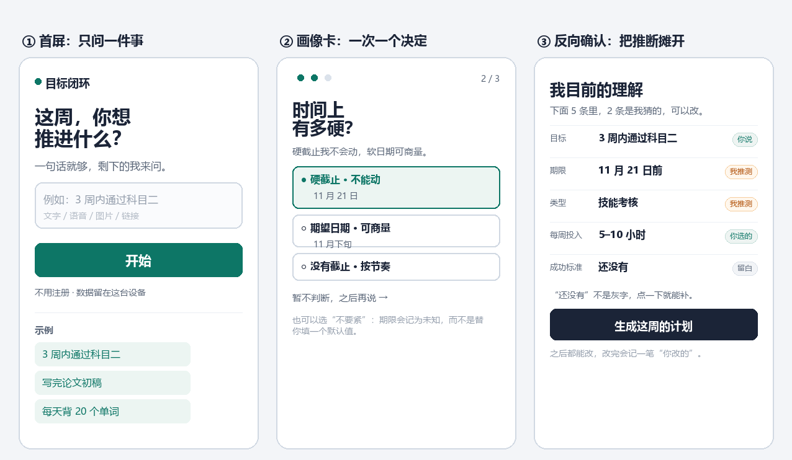

# 首次进入即画像

> 冷启动用户画像的交互、数据与实现设计

面向「目标 → 计划 → 执行 → 事实 → 反思」闭环　·　v1.1　·　2026 年 10 月 31 日


## 一、一页纸结论

用户第一次打开产品时，我们只知道 TA 点进来了。而产品要做的第一件事，是**因人而异地给出第一版计划**——这需要画像。但你们四份交互设计已经立好了规矩：不替用户判断目标、不静默推断、未知就是未知、AI 只呈现不评判。

所以本报告不建议做注册问卷，也不建议做性格测评。我们提出一套**以目标为入口的渐进式画像**：首屏只问一句话，画像从这句话里长出来；再用一次「反向确认」把系统的理解摊开给用户核对；其余字段在首周的自然节点各问一次；行为数据只生成带样本量、带区间、会过期的**估计**，永不写成事实。

本版还引入了一个更硬的前提：**人对自己的判断并不可靠**（第三章）。因此画像的证据权威按对象分配——约束与意图听用户，行为与节律听记录，人格不归任何人下结论。


### 三个机制

- **目标即入口**：首屏只有一个输入框，没有表单。用户为了拿到计划本来就要说目标，这句话里已经含了大部分画像字段。
- **反向确认**：AI 的每个推断都以「待确认」出现，逐条标注来源；用户改一次，来源就永久变成「你说」，系统不再覆盖。
- **行为校准**：行为数据只产出估计与默认值，不产出标签；估计要带样本量、区间和到期时间，并且用户能看见。


### 四个数字

- **3 张卡 / ≤60 秒**：首屏主动提问的上限，任何一张都能跳过
- **≤3 分钟**：从进入到看到第一版计划的目标时长（TTFT）
- **0 字段可进入**：画像完成度不是门槛，不是解锁条件
- **首周 ≤3 次**：自然节点上的即时提问（JIT）预算


### 与四份设计文档的关系

这份报告不是另起一套产品，而是给现有闭环补一个「入口」。它把文档 01 的「确认门」、文档 02 的「不必等 AI 问完」、文档 03 的「不回复即未知」、文档 04 的「事实 / 偏好 / 假设三分法」，原样搬到画像这一层：**画像不是档案，是一组可被质疑、可被撤销的假设。**

> **阅读路径**
> 只想看方案，读第六章与第七章；准备动手实现，读第八章到第十章；要定指标与验收，读第十一章；要排期和分工，读第十三章。第二章与第三章是前提，赶时间可先跳过。

> **v1.1 修订**
> 新增第三章「前提：人看不清自己，画像该信谁」，据此重写第三张卡的问题、增加 S6 校准会话与差异视图，补充客观载体清单、差异检测规则与「当系统比用户更了解用户」四道护栏；原第三至十四章顺延，表与图已重新编号。


## 二、为什么现在要解决这件事

「目标 → 计划 → 执行 → 事实 → 反思」这条闭环里，最难的不是生成计划，而是**第一版计划凭什么像为这个人做的**。同一个「三周内通过科目二」，对每天只有 40 分钟的人、对周末能练 6 小时的人、对已经挂了两次的人，应该排出完全不同的周计划。

如果第一版计划明显不对，用户不会走到反思环节——他会在第一天就删掉 App。所以画像的真正作用不是「了解用户」，而是**降低第一版计划的返工率**。这个定位决定了它应该记什么、不该记什么。

**表 1　画像要解决的三类返工**

| 返工类型 | 表现 | 缺少哪个字段 | 对应维度 |
| --- | --- | --- | --- |
| 时间不匹配 | 计划排满，但用户根本挤不出这些时间 | 周可投入量、可用时段 | 时间现实 |
| 验收不匹配 | 用户要的是「能上手」，系统却按「学完教材」拆 | 成功标准、验收方式 | 目标结构 |
| 节奏不匹配 | 每天排 2 小时，用户实际只能做 25 分钟 | 单次块长、估时偏差 | 执行节律 |

三类返工对应三个层次的画像：**声明层**（用户说的）、**校准层**（系统算的）、**协商层**（双方确认的）。一份合格的冷启动画像，应该在 3 分钟内把前两层的最小集拿到，并留下第三层的入口。


## 三、前提：人看不清自己，画像该信谁

你们分享的那篇笔记提出了一个很强的判断：**人其实无法洞察自己的真实人格，只有客观的载体才能观察并描绘一个人。** 上一版方案里「问出来的画像总是偏乐观」的现象，正好被这句话解释。但它也跨过了一步，而那一步恰好是产品伦理的边界。这一章先把前提说清楚，后面所有机制都从这里推导。


### 它说对了什么

自评在三个地方系统性失真。这不是态度问题，是仪器问题：

- **时间估计**：规划谬误让「这周能投 10 小时」平均高出实际三到五成，越不熟悉的任务偏得越多。
- **节律判断**：「我晚上效率高」是叙事，不是测量；真实的高峰常常出现在自述之外——通勤后、午休前、截止日当天。
- **回忆偏差**：人记得完成的那次，忘记跳过的五次；自评的完成率普遍高于记录。

所以凡是「关于自己怎么做事」的问题，自述只能当假设，不能当数据。这一点我们全盘接受，并把它写进了证据权重：**声明源只给初值，行为源负责校准。**


### 但它跨过了一步

「只有客观载体能洞察人格」这句话里，有三处不成立：

1. **载体只记录被设计的东西。** 埋点决定什么可见，没记录不等于没发生。文档 03 说「不回复则保持未知」，在数据层同样成立：缺席是缺席，不是否定。用户在线下练了两小时车，系统一秒都看不到。
2. **行为回答「什么」，不回答「为什么」。** 同一个「晚间 5 次完成 2 次」，可以是疲劳、被打断、任务太难、优先级变了，也可以只是那几天在加班。模式是事实，归因是解释。
3. **人格不是被观察到的，是被解释出来的。** 从行为到人格是一次跳跃；谁来完成这次跳跃，决定产品是助手还是裁判。

> **我们的立场**
> 接受它的方法论——证据优先、自述降权、多源交叉；拒绝它的结论——系统不能因此获得「定义用户是谁」的授权。用一句话说：**让记录负责事实，让用户负责意义。**


### 四类对象，四种证据权威

把「画像」拆开看，会发现不同对象的证据来源本来就不一样。把权威搞混，才会得出「自述没用」或「数据万能」这两种极端结论。

**表 2　四类画像对象与各自的证据权威**

| 对象 | 例子 | 谁能提供 | 证据权威 | 缺失时 |
| --- | --- | --- | --- | --- |
| 约束 | 期限、可用时段、可投入量 | 声明 + 日历 / 记录 | 声明给初值，记录做校验 | 未知，给保守默认 |
| 行为 | 实际何时做、做多久、中断几次 | 只有客观载体 | 记录优先，n≥3 才算模式 | 未知，不推断 |
| 意图 | 为什么做、什么算成功、想成为谁 | 只有本人 | 声明是唯一权威 | 未知，不替用户填 |
| 解释 | 「我总是拖延」还是「这周太忙」 | 本人 + 系统候选 | 用户选定后才生效 | 保留为未解释的模式 |

人格属于第四类。它不是被谁「洞察」出来的，而是行为证据与本人解释反复对照后的产物：系统可以提供候选解释，但签发权在用户。


### 落成权重

为了能写进代码，四类权威落成四个分数：声明 0.6 起，两个目标都一致 +0.2；观察 0.5 起，随样本量对数增长、上限 0.85，数据缺失扣分；用户确认 0.95；系统默认 0.2，且永不作为事实展示。分数只用于排序与是否展示，不用于给用户打分。

冲突时不覆盖，生成一条**差异记录**：声明值、观察值、证据条数、时间窗。差异不是错误，是这套方案里最有价值的信息——它既是校准入口，也是产品差异化的地方。


### 第一处产品变化：把问题从「你」改成「这件事」

这个前提立刻改掉了一句文案。原来问「你每周能投入多少？」，那是在要求自评；改成「这件事这周能分到多少时间？」，那是在问一个具体约束——锚定本周、锚定这个任务，可靠性高得多。第七章的三张卡都按这个原则重写过，附录 A 保留了改前改后的对照。


## 四、约束：你们的设计已经决定了答案的一半

在讨论怎么做之前，先把四份文档里的硬规则列出来。它们不是风格偏好，而是会直接否掉某些方案的产品承诺。

**表 3　四份设计文档对画像的硬约束**

| 文档 | 原文规则 | 对画像设计的直接约束 |
| --- | --- | --- |
| 01 产品闭环 | 只有用户确认的执行事实才能进入实际记录；未知不推断 | 画像字段同样需要确认门；「未知」是合法状态，不能用默认值冒充 |
| 02 目标到周计划 | 不要求先填满所有信息；用户随时可以主动推进，不必等 AI 问完 | 画像不能是前置表单，不能阻塞「开始规划」；必须允许 0 字段进入 |
| 03 执行变化 | 不回复则相关时段保持未知，绝不判定已分心 | 行为信号缺失时不得补全；不能由总时长推导次数 |
| 04 反思到下一轮 | 区分事实、用户偏好和未证实假设；不能直接贴自控力标签 | 画像必须三分法存储；推断必须先问、再记、可溯源 |

> **一个直接推论**
> 凡是「必填」「默认帮你选好」「根据行为猜出来」的设计，都在这四条里至少违反一条。可行的空间只剩下一个：**问得少、问得准、问得可拒绝，并且把「不知道」显式保留下来。**


## 五、画像的定义：六维、三层、五元组

「用户画像」这个词容易被理解成人口学档案。在本产品里，它应该被收窄成一句话：**为了把第一版计划做对，我们必须知道的六件事，以及我们有多确定。**


### 六维：只记与「能不能把计划做成」有关的

**表 4　画像的六个维度**

| 维度 | 回答什么问题 | 典型字段 | 首屏是否涉及 |
| --- | --- | --- | --- |
| 目标结构 | 要达成什么、怎样算成 | 领域、成功标准、验收方式 | 是（成功标准） |
| 时间现实 | 什么时候必须完成、有多少时间 | 期限类型、日期、周可投入、可用时段 | 是（期限、投入量） |
| 执行节律 | 什么时候做得动、一次能做多久 | 偏好时段、单次块长、估时偏差 | 否，行为校准 |
| 反馈习惯 | 愿意多频繁地说进展 | 反馈频率、渠道、最低成本方式 | 否，JIT 提问 |
| 反思偏好 | 想怎样回看 | 先看对照 / 先自己说、报告粒度 | 否，JIT 提问 |
| 授权边界 | AI 可以自动做什么 | 可移动对象、幅度、通知方式 | 否，排程时给默认 |

只有前两维必须在首屏拿到，因为它们是生成第一版计划的最小输入。后四维不知道也能出计划，只是第一版会更保守——这是可以接受的代价，比让用户在首屏填 8 个问题便宜得多。

还有一条更细的读法：六维里越靠「倾向」的维度（执行节律、反馈习惯），越依赖记录；越靠「意图」的维度（目标结构、反思偏好），越依赖自述。这张表其实是第三章那张证据权威表的展开。


### 三层：按生命周期分，不按主题分

**表 5　画像的三层生命周期**

| 层 | 范围 | 例子 | 保留策略 |
| --- | --- | --- | --- |
| 会话画像 | 本次进入 | 入口来源、本次意图、设备 | 不跨会话，除非用户确认 |
| 目标画像 | 与一个目标绑定 | 期限、成功标准、周投入 | 目标结束即归档 |
| 稳定画像 | 跨目标仍成立 | 偏好时段、反馈方式、反思偏好 | 需 ≥2 个目标一致才升级 |

默认只写目标画像。升级到稳定画像必须有重复证据，否则一次误判会污染之后所有目标，用户会觉得「你一直这么看我」——这是画像类产品最常见的信任崩塌方式。


### 五元组：每个字段必须带来源

**表 6　画像字段的五元组**

| 要素 | 说明 | 缺失时怎么办 |
| --- | --- | --- |
| 值 | 结构化取值，不是自由文本 | 不许入库 |
| 来源 | 用户明说 / 确认过的推断 / 行为校准 / 系统默认 | 不许入库 |
| 证据强度 | 该字段的证据分与样本量（0–1） | 低于 0.5 只能作为候选，不进反向确认 |
| 置信度 | 高 / 中 / 低；行为字段另带样本量与区间 | 降为候选，不作为事实使用 |
| 有效期 | 什么时候复核，过期自动降权 | 默认 30 天 |
| 可见性 | 用户可见 / 仅内部用于默认值 | 默认用户可见 |

我们把这个结构叫**画像护照**：用户点开任何一个字段，能看到「我是怎么知道这件事的、什么时候知道的、它什么时候会过期」。这是文档 04「可追溯」在画像层的直接实现，也是面对「你怎么知道」这类质疑时唯一的答案。


### 状态机：一个字段的一生

**表 7　画像字段状态机**

| 状态 | 含义 | 进入条件 | 退出条件 |
| --- | --- | --- | --- |
| 未知 | 用户没说，系统也不猜 | 初始 / 用户拒答 | 用户填写，或被确认的推断 |
| 候选 | 系统抽取，附原文出处 | 抽取通过 ground 与 verify；或由行为模式提出（n≥3） | 用户确认；或证据不足退回未知 |
| 已确认 | 用户确认或亲自填写 | 用户点击确认 / 编辑 | 到期未复核；或用户删除 |
| 已过期 | 到期未复核，降权使用 | review_at 到期 | 复核通过；或删除 |
| 已删除 | 用户删除，立即生效 | 用户删除 | 终态，不可从日志重建 |


## 六、方案：以目标为入口的渐进式画像


### 四条候选路径

在确定方案前，我们比较过四条可行路径。判断标准不是「哪个记得多」，而是「哪个能在 3 分钟内给出可用计划，同时不违反上文四条硬约束」。

**表 8　四条候选路径的取舍**

| 路径 | 做法 | 优势 | 代价 | 结论 |
| --- | --- | --- | --- | --- |
| A 注册问卷 | 首屏 8–10 题，一次问全 | 字段最全，实现最简单 | 与文档 02 冲突；流失集中在前两题；自报告偏差 | 不用 |
| B 目标式 + 3 卡 | 先给目标，再问 3 个关键约束 | 价值前置；问题在语境里；可整组跳过 | 字段少，需要首周补 | 采用 |
| C 纯行为推断 | 不问，只靠点击与完成率推 | 零打扰 | 违反「未知不推断」；冷启动样本不足；易标签化 | 不用 |
| D 目标式 + 0 卡 | 只问目标，其余全部 JIT | 最快进入计划 | 首版计划假设过多，返工率高 | 留作实验组 |

我们选 B，并把 D 留作实验组（见第十一章）。C 被否掉有两个原因：伦理上违反「未知不推断」，方法上也不成立——意图与意义不可观察，纯行为推断会把「想成为谁」猜成「过去做了什么」。C 唯一保留的用途是**默认值与排序**，不写入任何用户可见的字段。


### 方案全貌

整条路径只有五个主动步骤，总时长控制在 100 秒左右，之后交给现有的排程流程。用户看到的不是「完善资料」，而是「我正在把这件事排进你的时间」。


*图 1　冷启动流程与时间预算：目标先于画像，确认先于入库*


### 为什么不是问卷

1. **价值顺序错了。** 用户来是为了「把事排进去」，不是来填表。问卷把价值推到 3 分钟之后，流失会集中在第二题。
2. **自报告不准。** 用户对「每周能投入几小时」「什么时候效率高」的回答是愿望，不是事实。愿意填完 8 题的人，本身已经是高意愿样本，数据有偏。
3. **与文档 02 直接冲突。** 那边明确写了「不要求先填满所有信息」「不必等 AI 问完」。一张必填问卷会把这条原则当场作废。
4. **问错了东西。** 问卷擅长问身份（职业、年龄、目标类型），而排程需要的是约束（期限、可用时段、估时）。约束离开具体目标就问不准。
5. **问的姿势也不对。** 同样是问投入，「你每周能投入几小时」是在要一个自我评价，「这件事这周能分到几小时」是在问一个具体约束。前者按第三章的判断不可信，后者可以当场核对。


### 为什么「目标即入口」成立

用户为了得到计划，本来就要描述目标；这句话里已经含有大部分字段。例如：

> 「下个月 15 号前把论文初稿写完，每周大概能挤 10 小时。」

**表 9　一句目标里能读出的字段**

| 原话片段 | 可读出字段 | 置信度 | 处理 |
| --- | --- | --- | --- |
| 下个月 15 号前 | 期限 = 硬截止，2026-11-15 | 高 | 候选，默认勾选 |
| 论文初稿 | 领域 = 写作；成功标准 = 有明确交付物 | 中 | 候选，请用户点一下 |
| 每周大概能挤 10 小时 | 周可投入 = 10h 档 | 中 | 候选，转为区间值 |
| 「大概」「挤」 | 时间压力高、投入不稳定 | 低 | 不入库，只影响追问时机 |

注意最后一行：**读得出但不够确定的，不进画像，只影响提问。** 这不是技术限制，是产品态度——「大概」两个字撑不起一条写进档案的结论。


## 七、交互规格：五个步骤与一次握手


### S0 首屏：只问一件事

一句话、一个输入框、一个按钮。没有轮播、没有功能介绍、没有「下一步」。三个示例 chip 直接可点，点了就填进输入框——降低「不知道写什么」的启动成本。

- 小字承诺「不用注册 · 数据留在这台设备」，作用是降低第一次输入的心里成本，而不是满足合规。
- 语音、图片、链接收在输入框右侧的「+」里，不占首屏注意力。
- 空提交不报错，改为高亮示例；首屏任何交互都不应出现红色。
- 首屏不出现「画像」「资料」「设置」这些词——用户此刻不关心我们怎么称呼它。


### S1 目标草稿：先建档，再理解

提交即建目标草稿，不要求用户确认格式；文档 02 已经规定「文字 / 语音 / 图片 / 链接均先进入目标草稿」。建档在 100 毫秒内完成，抽取并行进行，慢不阻塞。

草稿页只显示「我读到的」三个要点：做什么、什么时候、多久。抽取没回来就先显示原文，用户可以不等，直接点「继续」。


### S2 画像速写：三张卡，一次一个决定

**表 10　三张画像卡**

| 卡 | 问题 | 选项 | 不选时如何处理 |
| --- | --- | --- | --- |
| 1 | 怎样算成？ | 有明确交付物 / 掌握一项能力 / 养成一个习惯 / 先开始再说 / 说不清，先帮我拆 | 记为未知；计划按「先开始」处理 |
| 2 | 时间上有多硬？ | 硬截止（选日期）/ 期望日期（选日期）/ 没有截止 | 记为未知；计划给一个检查点，不给截止压力 |
| 3 | 这件事这周能分到多少时间？ | <2h / 2–5h / 5–10h / 10h+ / 不确定，先排排看 | 记为未知；本次用 4h 保守默认，标注「暂定」 |

- 一次只出现一张卡，卡片之间是替换而不是堆叠；底部三个点表示进度，不显示百分比。
- 「暂不判断」和正常选项同样显眼，不是灰色小字。这是产品态度，不是逃生通道。
- 选「不确定」不等于没回答：它本身是一条信息（用户此刻不愿承诺投入量），要记下来，避免下次再问。
- 整组可跳过，跳过后直接进入排程；跳过行为记为「低意愿填写」，用于调整后续提问时机，而不是记为「用户不配合」。
- 三张卡都不问「你是什么样的人」——按第三章，那类问题恰恰是自评最不可靠的地方；它们只问这件事的约束。



*图 2　三个关键界面的线框：首屏、画像卡、反向确认*


### S3 反向确认：最重要的 15 秒

这一屏把系统的理解全部摊开，逐条标注来源，并把「不知道」也写出来：

> 你的目标：3 周内通过科目二　　期限 11 月 21 日前（你说）｜ 类型 技能考核（我推测）｜ 每周投入 5–10 小时（你选的）｜ 成功标准 还没有（留白）｜ 方便练车的时段 还不知道（排程时再问）

三条硬规则：

1. 只显示有来源的字段；没有来源的显示「还没有」，并且**可点**，不是灰色占位。
2. 「我推测」必须有改的入口；改一次后来源变为「你说」，此后系统不得覆盖。
3. 用户改完后旧值不删除，记为 superseded，供反思时对照（「你当时说是考试，后来改成路考」）。

回访用户会多一行「记录」：过去 7 天你在晚间安排了 3 次、完成 1 次（可点开看是哪几天）。它和「你说」并列显示，不合并、不覆盖。

> **为什么这一步不能省**
> 它同时完成三件事：校准数据、建立信任、把「画像」这件事本身讲清楚。用户看完这一屏，会知道系统知道什么、不知道什么、为什么——这正是四份文档反复强调的角色定位。跳过它，画像就变回了后台偷偷积累的档案。


### S4 交接：允许「信息不全」进入排程

交接条件只有一条：能生成一版「现在就能开始」的计划，而不是「信息齐全」。缺项按文档 02 的规则处理——补一项、接受明确估值、只存目标，三选一，不强迫。

首版计划必须标出它基于哪些假设（例如「按每周 5 小时排的」），并提供「改假设」的入口。假设可见，计划才可被质疑；计划可被质疑，用户才会相信它。


### S5 首周即时提问：把剩下的问题放回语境

**表 11　三个自然节点，每次只问一句**

| 触发点 | 缺什么 | 只问一句 | 不问的后果 |
| --- | --- | --- | --- |
| 首次排程前 | 可用时段 | 你一般哪天、哪个时段方便？ | 计划排在你可能没空的时间 |
| 首次反馈后 | 反馈偏好 | 以后我提醒你，还是只记录？ | 提醒过度导致关通知，或反馈断流 |
| 首次反思后 | 反思偏好 | 下次复盘，先看对照，还是先自己说？ | 报告形式不对，用户直接不复盘 |

规则：一次只问 1 个；同一个问题 7 天内不重复；首周总计 ≤3 次；用户拒绝后 30 天静默。拒绝本身记为「偏好不填」，而不是「未知」——这两者在后续的默认值选择上完全不同。


### S6 校准会话（T+7）：三条差异

第一次校准发生在第七天，而不是每天。每天提醒会把「观察」变成「监视」；一周一次，样本量刚好够说一句话，也给了用户回看的时间。


*图 3　校准会话：把「记录里的你」和「你说的你」并排放，结论留给用户*

- 最多 3 条差异，按证据强度排序；每条都能点开看原始事件（哪天、几点、做了什么）。
- 两个选项加一个退出：「是我」「只是这周」「以后别再提」。第三个选项必须存在，否则用户只能用否认来表达不适。
- 选「是我」→ 写入解释字段（用户认为……），观察值降为背景；选「只是这周」→ 观察值保留但降权，7 天后再看；选「别再提」→ 该维度进入 90 天静默。
- 差异为 0 时也要有一屏：「这周记录和你说的一致」，并给一条下周的小建议——正向确认同样是校准。


### 四种进入状态

**表 12　不同入口的差异化处理**

| 进入状态 | 已有信号 | 首屏变化 | 不问什么 |
| --- | --- | --- | --- |
| 完全新用户 | 无 | 标准 S0–S4 | — |
| 已授权日历 | free/busy、工作日历 | 跳过可用时段，直接计算 | 不问「你哪天方便」 |
| 被邀请（共享目标） | 他人目标、角色权限 | 显示邀请人与权限，只收集投入与偏好 | 不问目标本身 |
| 回访换目标 | 稳定画像 | 复用偏好，只问目标字段 | 不问反馈与反思偏好 |


### 文案原则

- 动词开头，一句话说完；不用「请填写」「请输入」。
- 不承诺「我懂你」，只承诺「我记着，你可以改」。
- 「暂不判断」优于「跳过」：前者是产品态度，后者是用户失败。
- 加载超过 800ms 要说「我正在读你说的这句话」，不要转圈。
- 错误不指责用户：「这句话我没读太明白，你再说一句？」


## 八、数据模型


### 实体

**表 13　画像相关实体**

| 实体 | 作用 | 关键字段 |
| --- | --- | --- |
| profile | 一个用户的画像容器 | id、subject_id、locale、tz、consent_scope、schema_version |
| profile_field | 字段级记录 | key、value_json、source、confidence、status、scope、valid_from、review_at、superseded_by |
| profile_evidence | 来源证据 | field_id、kind（utterance / event / import）、ref、quote、captured_at |
| behavior_event | 客观载体原始事件（只记事实） | id、subject_id、kind、started_at、ended_at、source、payload |
| difference | 声明与观察的差异 | field_key、declared、observed、n、window、status（open / accepted / dismissed） |
| profile_event | 审计流水 | field_id、action、actor（user / ai / system）、before、after、at |
| goal | 目标（已有实体） | id、profile_id、text、status |

行为账本只记事实：时间戳、时长、是否完成、改了几次、延迟多久。不记判断，不写「拖延」「专注度」这类字段。原始事件保留 90 天，聚合之后才允许进入画像。


### 字段字典

**表 14　首屏与首周涉及的字段**

| 字段 key | 含义 | 取值 | 来源 | 首屏 | 缺失处理 |
| --- | --- | --- | --- | --- | --- |
| goal.domain | 目标领域 | 学习 / 工作 / 健康 / 创作 | 推断 | 否 | 仅用于模板 |
| goal.success_criteria | 成功标准 | 交付物 / 能力 / 习惯 / 开始 | 卡片 1 | 是 | 按「先开始」 |
| goal.deadline_type | 期限硬度 | hard / soft / none | 卡片 2 | 是 | 给一个检查点 |
| goal.deadline | 具体日期 | ISO 日期 | 卡片 2 | 是 | 记为未知 |
| capacity.weekly_hours | 周可投入 | 区间（h） | 卡片 3 | 是 | 暂定 4h |
| capacity.block_minutes | 单次块长 | 25 / 45 / 60 / 90 | 行为 | 否 | 默认 45 |
| rhythm.preferred_window | 偏好时段 | 早 / 午 / 晚 / 夜 | 行为 | 否 | 按空闲推断 |
| execution.estimate_bias | 估时偏差 | 区间 % | 行为 | 否 | 不展示 |
| feedback.cadence | 反馈偏好 | 每次 / 每日 / 每周 | JIT | 否 | 每日一次 |
| reflection.style | 反思偏好 | 先对照 / 先自己说 | JIT | 否 | 先对照 |
| automation.boundary | 授权边界 | 每次确认 / 边界内自动 | 设置 | 否 | 每次确认 |
| privacy.share_scope | 可见范围 | 仅自己 / 团队 | 设置 | 否 | 仅自己 |

来源取值统一为五类：declared、confirmed_inference、observed、derived、default。前两类是「你说」，observed 是「记录」，derived 是「我算的」，default 只在本次会话生效、不入库。


### 示例：一个字段长什么样

```json
{
  "key": "goal.deadline",
  "value": { "type": "hard", "date": "2026-11-21" },
  "source": "confirmed_inference",
  "confidence": { "band": "high", "score": 0.92 },
  "status": "confirmed",
  "scope": "goal:g_8f21",
  "evidence": [
    { "kind": "utterance", "ref": "turn_1", "quote": "11 月 21 号考试", "at": "2026-10-31T09:12:03+08:00" }
  ],
  "valid_from": "2026-10-31",
  "review_at": "2026-11-21",
  "version": 2,
  "superseded_by": null
}
```


### 画像与记忆的边界

**表 15　画像记「怎么协作」，记忆记「发生了什么」**

|  | 画像 | 记忆 |
| --- | --- | --- |
| 内容 | 跨目标稳定的少量字段 | 目标内的事实、解释与假设 |
| 数量 | 首周 ≤8，长期 ≤20 | 不设上限，随目标归档 |
| 写入 | 需确认或重复证据 | 可自动写入，但必须标来源 |
| 删除 | 字段级删除 | 目标级删除 + 单条删除 |
| 用途 | 生成默认值、排序、决定问什么 | 生成对照报告、反思素材 |

这条边界不划清，画像会膨胀成档案：用户三个月后打开，看到 60 条关于自己的判断，第一反应是「你凭什么」。


### 版本、过期与删除

- 每次修改生成新版本，旧版本保留为 superseded，用于展示「你改过什么」。
- 行为字段 30 天过期，JIT 偏好 90 天，声明字段随目标结束归档。
- 删除是硬删除，24 小时内清备份；删除后不得从行为日志重新推导，需要写入 do_not_infer 名单。


## 九、推断与校准：让系统敢说「不知道」


### 抽取管线

**表 16　从一句话到候选字段的五步**

| 步骤 | 做什么 | 失败时 |
| --- | --- | --- |
| normalize | 语音转写、语言与时区识别、去噪 | 保留原文并标注「未转写」 |
| extract | LLM 结构化输出，每个字段必须带 quote | 无 quote 的字段直接丢弃 |
| ground | quote 必须能在原文中精确匹配 | 匹配失败 → 丢弃整个字段 |
| verify | 二次判定「这句话是否支持该取值」 | 回答 ambiguous → 降为提问候选 |
| band | 规则映射置信度档位 | 无法映射 → 低置信，不入库 |

关键不是让模型多抽，而是让它敢不抽：schema 里所有字段 optional，输出 null 永远优于猜。评测时把「该抽没抽」和「不该抽却抽了」分开计分，后者是更严重的错误。


### 置信度分级

**表 17　四档置信度与处理方式**

| 档位 | 判定依据 | 处理 |
| --- | --- | --- |
| 高 | 原话直接陈述，如「我下周三要交」 | 进入候选，反向确认时默认勾选 |
| 中 | 单句可直接推出，如「三周后考试」 | 进入候选，需用户点一下确认 |
| 低 | 需跨句或常识补全，如「最近有点忙」 | 不进画像，只作为提问素材 |
| 禁止 | 需推测人格、能力、健康、身份 | 不生成，也不进日志 |


### 禁推断清单

人格特质、自控力与拖延、心理健康、身体健康、智力与能力、政治宗教、性取向、精确收入、家庭关系、精确位置（粗于城市即不需要）。

这份清单要同时写进 prompt、服务端白名单和评测集。只在 prompt 里写「不要推断」，模型迟早会越界；只在服务端拦，用户已经看到了越界的文案，信任已经损失。


### 客观载体：能看见什么，看不见什么

**表 18　客观载体清单**

| 载体 | 能看到 | 看不到 | 用来做什么 |
| --- | --- | --- | --- |
| 日历 free/busy | 已有会议、忙碌块 | 会议之外的实际使用 | 算可用时段，免去「你哪天方便」 |
| 任务完成记录 | 开始与结束时间、是否完成、是否改期 | 为什么没做 | 估时偏差、时段完成率 |
| 编辑与预览行为 | 改了几处、改多久、是否放弃 | 改的原因 | 计划颗粒度偏好 |
| 反馈时延 | 计划结束到反馈的间隔 | 反馈那一刻的真实状态 | 追问时机 |
| 目标修订史 | 改目标、减范围、暂停的时刻 | 动机变化 | 判断该减量还是该换目标 |

这张表也标出了边界：**每一行都有一列「看不到」**。看见的越多，越要提醒自己没看见什么；否则「客观」会变成新的偏见。


### 行为校准：不用 LLM，用统计与克制

**表 19　四个校准指标**

| 指标 | 定义 | 用途 | 门槛 |
| --- | --- | --- | --- |
| estimate_bias | median(实际时长 / 计划时长) | 生成计划时按偏差放大估时 | n ≥ 3 |
| plan_edit_rate | 编辑后应用次数 / 预览次数 | >0.6 时默认给 2–3 个候选方案 | n ≥ 5 |
| feedback_latency | 中位数(计划结束 → 反馈) | >18h 时追问改到次日早间一次 | n ≥ 3 |
| slot_completion | 各时段完成率 | 最高与最低差 ≥25pp 时提出假设 | n ≥ 5 |

所有行为字段都写 status = estimated，带区间与 review_at，并在画像页明确写「这是我算的，不是你告诉我的」。


### 假设要用问句说出来

不要说「你晚上效率低」，要说「你最近 5 次晚间安排完成了 2 次，是不是晚上更容易被别的事打断？」结构是：**给观察（次数）→ 给不确定（是不是）→ 给否定的空间 → 用户确认后才写入**，并且写成「用户认为晚间易被打断」，而不是「用户晚间效率低」。前者是用户的解释，后者是我们的判词。


### 差异检测：只在够格的时候说话

差异 = 声明值 与 观察分布 的距离。说话的门槛是三条同时成立：样本 ≥3；差异超过噪声（时长类 >25%，时段类跨 2 个档位以上）；时间窗内没有重大外部事件（换工作、考试周、生病）。任一条不成立，只更新内部权重，不出现在界面上。

每个模式假设还要带**失效条件**：「如果接下来 3 次晚间安排都完成，就撤回这条。」没有失效条件的假设，迟早会变成标签。


### 衰减与复核

**表 20　不同字段的有效期**

| 字段类型 | 有效期 | 到期动作 |
| --- | --- | --- |
| 声明（期限、成功标准） | 随目标 | 归档，不跨目标复用 |
| 偏好（反馈、反思） | 90 天 | 提示复核一次，不自动修改 |
| 行为估计 | 30 天 | 降权，不删除 |
| 授权边界 | 长期有效 | 每次改动留痕，随版本回滚 |


## 十、技术实现


### 前端状态机

**表 21　引导流程状态机**

| 状态 | 事件 | 下一状态 | 副作用 |
| --- | --- | --- | --- |
| idle | goal_submitted | sketching | 建草稿、发起抽取 |
| sketching | answer / skip | sketching / reviewing | 写入候选字段 |
| reviewing | confirm_all | handoff | 提交字段、请求生成计划 |
| reviewing | edit_field | reviewing | 旧值标 superseded |
| handoff | plan_ready | done | 埋点、关闭引导、显示画像入口 |

草稿存 localStorage（键 profile.draft.v1），刷新可恢复；提交幂等键取 hash(guest_id + goal_text + step)，重复提交不产生重复字段。断网时 S0–S2 仍可用，抽取排队重试。


### 接口

**表 22　最小接口集**

| 方法 | 路径 | 用途 | 关键返回 |
| --- | --- | --- | --- |
| POST | /v1/session/guest | 免注册身份 | guest_token |
| POST | /v1/goals/draft | 建目标草稿 | goal_id、status |
| POST | /v1/profile/extract | 抽取候选字段 | candidates[]、unknowns[] |
| POST | /v1/profile/fields/{key}/confirm | 确认字段 | 字段版本号 |
| GET | /v1/profile?scope=goal:{id} | 读取画像护照 | fields[] |
| PATCH | /v1/profile/fields/{key} | 修改或删除 | 新版本 |
| POST | /v1/events | 埋点批上报 | 202 |

```json
POST /v1/profile/extract
{ "goal_id": "g_8f21", "text": "3 周内通过科目二，11 月 21 号考试" }

200 OK
{
  "candidates": [
    { "key": "goal.deadline", "value": {"type":"hard","date":"2026-11-21"},
      "band": "high", "quote": "11 月 21 号考试", "span": [13, 22] },
    { "key": "goal.domain", "value": "学习", "band": "medium", "quote": "科目二" }
  ],
  "unknowns": ["goal.success_criteria", "capacity.weekly_hours"],
  "latency_ms": 840
}
```


### 存储与治理

- 字段级加密：sensitive = true 的字段单独加密，密钥与主库分离。
- 审计：每次写入 profile_event，包含 actor、before、after，可回放。
- 导出：GET /v1/profile/export 返回 JSON 与一份人类可读摘要。
- 模型侧最小化：只发当前目标相关字段，不发历史画像全文。


### 性能与降级

**表 23　预算与降级路径**

| 场景 | 目标 | 降级 |
| --- | --- | --- |
| 首屏 LCP | ≤1.2s | 静态骨架 + 本地缓存 |
| 抽取 P95 | ≤2.5s | 超时则卡片不预填，直接问 |
| 抽取 schema 失败 | 不部分采用 | 整批丢弃，按未知处理 |
| 断网 | S0–S2 可用 | 本地规则抽取（日期、领域关键词），标 low |
| 用户全部跳过 | 仍能出计划 | 用保守默认值，标「暂定」 |


### 与现有 Demo 的接入点

- 首屏作为新的入口页，提交后把目标草稿交给现有调度器，复用 index.html 里的周历与预览逻辑。
- 抽取结果直接映射为调度参数：周投入 → Focus 目标小时数；硬截止 → Task 截止日；可用时段 → Scheduling Hours。
- 反馈与调整写回后，只更新 estimate_bias 等估计字段，不改任何声明字段——这条边界要在代码里用类型系统守住。


## 十一、怎么判断做对了


### 北极星指标

**首周「计划被接受且至少产生 1 次执行反馈」的用户占比。** 不是画像完成率。完成率是只对我们有意义的指标；用户不关心画像，只关心计划能不能用。

**表 24　漏斗与健康区间（首版假设，需实测校准）**

| 阶段 | 指标 | 健康区间 |
| --- | --- | --- |
| 进入 → 输入目标 | 提交率 | ≥55% |
| 输入 → 看到计划 | TTFT P50 | ≤2 分钟 |
| 看到 → 接受 | 首计划接受率 | ≥55% |
| 接受 → 反馈 | 24h 内反馈率 | ≥40% |
| 反馈 → 第二轮 | 7 日回访率 | ≥35% |


### 画像质量指标

- 字段修正率 <15%：用户几乎不改，说明推断准。
- 候选采纳率 60–80%：太高说明系统只是在复述用户，太低说明抽取不准。
- 未知字段占比 20–40%：长期接近 0，说明系统在假装知道。
- 删除与投诉 <1%，且每条都有归因。
- 声明与观察的一致率（分维度）：太低说明声明不可信或仪器有问题；长期太高说明观察没有信息量。
- 差异采纳率 40–60%：太高说明措辞太强（用户被迫认同），太低说明观察不准。
- 校准后 7 日计划接受率：与校准前对比，用来证明「看见」确实有用。


### 实验设计

**表 25　三组对照**

| 组 | 方案 | 预期 |
| --- | --- | --- |
| A | 8 题问卷（对照） | 画像更全，但 TTFT 长、首屏流失高 |
| B | 目标 + 3 张卡（推荐） | 首计划接受率不劣于 A，TTFT 显著更短 |
| C | 目标 + 0 张卡，全部 JIT | 完成率最高，但首计划修改率更高 |

主指标为首计划接受率，非劣效界值 5 个百分点；每组约 220 人（α = 0.05，power = 0.8，基线 55%）。若 C 不劣于 A 且 TTFT 更短，下一版直接砍掉卡片——少问三个问题，比多记三个字段更值钱。


### 评测集

准备 20 条真实用户原话，含口语、方言、语音转写错误，人工标注期望字段与「不该抽」的字段。每次改 prompt 跑一遍，看召回率、误抽率、quote 命中率三个数。这比在会议室里讨论「模型好像变聪明了」可靠。


## 十二、隐私、伦理与角色边界

- **最小化**：首屏不问与排程无关的信息；游客模式可完整体验。
- **告知**：首屏小字与画像页都说明「这些信息用来生成计划，可随时查看、修改、删除」。
- **敏感属性**：不采集；模型侧执行禁推断清单；行为日志脱敏。
- **训练**：默认不用于模型训练，需要单独同意，且可撤回。
- **未成年人**：不做推断式画像，不采集位置。
- **角色边界**：AI 呈现事实与对照，用户负责解释与决定；画像是协作说明书，不是心理诊断。


### 当系统比用户更了解用户

这个前提最危险的用法，是把它变成家长式权威：「你不如我了解你自己，所以听我的。」四道护栏必须同时在：

1. **证据可展开**：任何一条观察都能点回原始事件；不能展开的结论不许展示。
2. **解释权归用户**：系统只出候选解释，用户选定才生效；用户可以否掉任何一条。
3. **观察可关闭**：设置里一键关闭行为推断，回到纯声明模式，且服务不降级。
4. **不做预测性断言**：不说「你大概率会放弃」，只说「过去 3 次类似安排完成了 1 次，要不要把范围缩小？」


## 十三、落地计划


### P0：4–6 小时可演示

**表 26　P0 范围**

| 模块 | 做法 | 工时 |
| --- | --- | --- |
| 首屏 + 目标草稿 | 复用现有单页结构，新增入口视图 | 1h |
| 抽取 | 本地关键词规则 + 可选真实模型调用（开关切换） | 1.5h |
| 三张卡 + 反向确认 | 纯前端，localStorage 存草稿 | 2h |
| 画像页 | 列表 + 来源徽标 + 编辑 / 删除 | 1h |
| 差异卡片 | 写死 3 条差异，演示选择与写回 | 0.5h |
| 埋点 | console 打点即可，不接后端 | 0.5h |

P0 不追求准确率，追求「流程讲得通、每一步都能解释」。演示时把模型调用失败也演一遍，反而是加分项——它证明系统在信息不足时的行为是设计过的，而不是撞运气。


### P1 / P2

- P1：行为校准、JIT 提问、审计与导出、A/B 埋点、禁推断名单的服务端校验。
- P2：稳定画像升级、多目标画像、团队共享权限、记忆的复核与清理。


### 90 秒演示脚本

**表 27　演示分镜**

| 时间 | 画面 | 台词 |
| --- | --- | --- |
| 0–10s | 首屏，只有一个输入框 | 第一次打开，我们只问一句话。 |
| 10–25s | 输入「3 周内通过科目二」，抽取结果浮现 | 这句话里已经有期限和领域，我只把不确定的部分标出来。 |
| 25–45s | 三张卡快速点选，第三张故意跳过 | 三个问题，全部可以跳过。 |
| 45–60s | 反向确认，改掉「技能考核」 | 我猜错了，改一下——它记住的是我改的，不是我猜的。 |
| 60–75s | 生成周计划，复用日历 demo | 到这一刻才第一次生成计划，前面 75 秒没有被浪费。 |
| 75–90s | 反馈后弹出 1 条差异：你说 45 分钟，记录 28 分钟 | 这条是它观察的，标着估计；我可以说是、说只是这周，或让它别再提。 |


### 分工建议

- 前端：状态机、卡片、画像页、降级路径。
- 后端：字段模型、审计流水、删除链路、导出。
- Prompt 与评测：抽取 schema、20 条评测集、禁推断清单、二次校验。
- 设计：文案、空状态、来源徽标、四种进入状态的差异。


## 十四、风险与待拍板的问题

**表 28　主要风险**

| 风险 | 触发信号 | 缓解 |
| --- | --- | --- |
| 画像变问卷 | 卡片完成率低、TTFT 上升 | 3 张卡硬上限；全跳过路径；卡片改为可折叠 |
| 推断越界 | 出现「拖延」「自控力」类字段 | prompt + 服务端白名单 + 评测集红线 |
| 假精确 | 用户质疑「你怎么知道」 | 估计必须带区间、样本量、到期时间 |
| 首屏变慢 | LCP >1.5s | 并行抽取、超时降级、骨架屏 |
| 共用设备 | 同一 guest 多个使用者 | 画像绑 subject 而非设备；提供「换个人用」 |
| 画像膨胀 | 字段数 >20 | 目标结束归档；稳定画像升级需重复证据 |
| 客观载体崇拜 | 把埋点当真相，忽略未记录的行为 | 缺席即未知；每条观察可展开；假设带失效条件 |

**表 29　需要团队拍板的六个问题**

| 问题 | 我们的建议 |
| --- | --- |
| 画像完成度是否解锁计划？ | 否，允许 0 字段进入；完成度只做诊断指标 |
| 行为推断默认开还是关？ | 默认只用于默认值与排序，跨会话使用需用户确认 |
| 首周允许主动提问几次？ | ≤3 次，且必须落在自然节点上 |
| 稳定画像升级门槛？ | 同一偏好在 2 个目标中被确认，才升级 |
| 画像归谁？ | 归用户：可导出、可删除、团队不可见 |
| 行为观察默认开还是关？ | 默认开，但只用于默认值与差异提示；关闭后不降级 |


## 附录 A　文案库

**表 30　首屏到首周的固定文案**

| 位置 | 文案 | 备注 |
| --- | --- | --- |
| 首屏标题 | 这周，你想推进什么？ | 问事，不问人 |
| 首屏副标 | 一句话就够，剩下的我来问。 | 承诺低负担 |
| 首屏小字 | 不用注册 · 数据留在这台设备 | 降低第一次输入的心里成本 |
| 卡片 1 | 怎样算成？ | 选项见正文 |
| 卡片 2 | 时间上有多硬？ | 硬 / 软 / 无 |
| 卡片 3（改前） | 这周能投入多少？ | 要求自评，可靠性低 |
| 卡片 3（改后） | 这件事这周能分到多少时间？ | 问约束，可核对 |
| 校准标题 | 过去 7 天，记录和你的说法有 3 处不一样 | 差异不是错误 |
| 校准选项 | 是我 / 只是这周 / 以后别再提 | 第三个选项必须有 |
| 跳过 | 暂不判断，之后再说 | 不用「跳过」 |
| 反向确认标题 | 我目前的理解 | 「理解」而非「资料」 |
| 反向确认说明 | 下面 5 条里，2 条是我猜的，可以改。 | 提前承认不确定 |
| 空字段 | 还没有 | 可点击补录 |
| 生成按钮 | 生成这周的计划 | 动词 + 时间范围 |
| 失败 | 这句话我没读太明白，你再说一句？ | 不指责 |


## 附录 B　参考资料

- 《产品闭环｜当前共识与建议补充的决策门》（01-product-loop）。
- 《目标到周计划｜人掌握推进权，系统提示可行性》（02-planning-interaction）。
- 《执行变化｜先补事实，再判断未来如何调整》（03-adjustment-interaction）。
- 《反思到下一轮｜AI 提供依据，用户解释与决定》（04-reflection-interaction）。
- Reclaim 2.0 公开资料：Preview Mode、Auto-lock、Priority、Scheduling Hours 等机制说明，仅作为「人掌握最终控制权」的旁证。

说明：文中百分比、时长与样本量为设计假设；四份设计文档原文以附件 HTML 为准。
